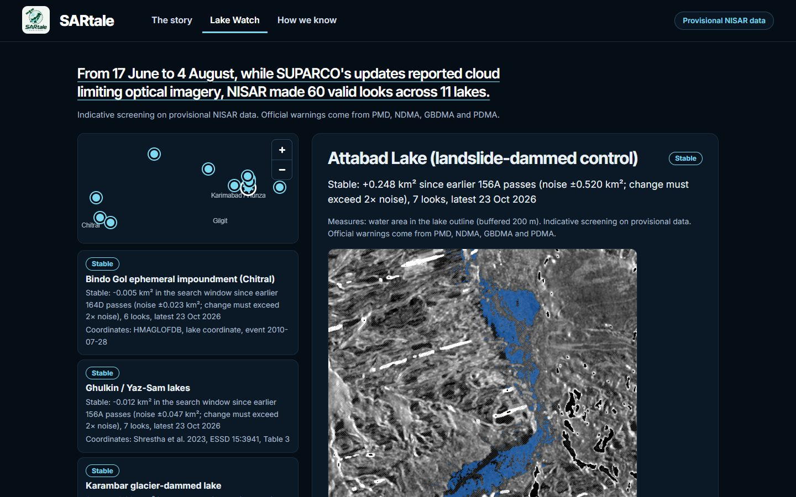
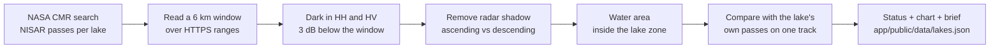

<p align="center">
  
</p>

<h1 align="center">SARtale</h1>

<p align="center">
  <b>When clouds close in, the lakes stay in view.</b><br/>
  Glacial lakes in Gilgit-Baltistan and upper Khyber Pakhtunkhwa, watched through cloud with NASA–ISRO NISAR radar.
</p>

<p align="center">
  NASA Space Apps Challenge 2026 · <i>Dancing with the SARs</i> · Islamabad local event<br/>
  Team <b>SARcastic Scientists</b>: Saeed Ahmad, Shaharyar Sajid, Usama Hussain
</p>

| Video | Length | |
|---|---|---|
| [Demo](media/SARtale-lake-watch-demo.mp4) | 38 s | What the app does ([subtitles](media/SARtale-lake-watch-demo.srt)) |
| [How it works](media/SARtale-how-it-works.mp4) | 3 min 41 s | The method, step by step, on real Attabad data ([subtitles](media/SARtale-how-it-works.srt)) |


## Why

Pakistan has more than 3,000 glacial lakes (UNDP GLOF-II). SUPARCO, Pakistan's space agency, tracks 131 of them as potentially dangerous, mostly with optical satellites. But the lakes fill in summer, and summer brings cloud. SUPARCO's [2 July 2026 update](https://space4climate.gov.pk/glof-status-update/) says:

> "Persistent cloud cover after 16 June 2026 has limited the availability of cloud-free satellite imagery, making it difficult to accurately assess lake area changes during the last three to four days."

Radar sees through cloud, day or night. From 17 June to 4 August 2026, while cloud limited the optical checks, NISAR made **60 valid looks across the 11 lakes** SARtale watches.

## What it does

- **Watches 11 lakes**, glacier-dammed, moraine-dammed and one landslide-dammed control (Attabad), across Hunza, Chitral and upper KP.
- **Gives each lake one plain status**: Growing, Stable, Shrinking, Not seen this pass, Not observable, or Not enough NISAR looks yet. All 11 read Stable in this build.
- **Shows every pass on a chart**, with the lake's own noise band, and lists the passes left out with the reason.
- **Prints a one-page brief** per lake: dates, looks, noise and limits.
- **Takes requests for new lakes.** A visitor names a lake and a coordinate; SARtale asks NASA's catalogue how often NISAR passes over it, and the team decides. See [docs/LAKE_REQUESTS.md](docs/LAKE_REQUESTS.md).



## How it works



1. **Find passes.** For each lake, search NASA's CMR catalogue for NISAR L2 GCOV granules (provisional, CRID `P05023`).
2. **Read only what is needed.** Fetch a 6 km window around the lake with HTTP range requests, never the whole file.
3. **Find water.** After a 3-pixel speckle filter, a pixel is water-like if it is at least 3 dB darker than the window median in both HH and HV. Calm water reflects radar away, so it looks dark.
4. **Remove shadow.** A steep slope facing away from the satellite looks dark too. NISAR sees each lake heading north and heading south. A lake is dark from both directions; a shadow is dark from only one, so it is set aside.
5. **Measure.** Count water inside the lake zone: the OpenStreetMap outline buffered by 200 m for Attabad, a 1 km circle around a published coordinate for the others.
6. **Decide.** Compare each pass only with earlier passes from the same track. A change counts only if it is more than twice the lake's own noise, with at least 3 looks. A pass whose whole window is far brighter or darker than the track's other passes is left out, and the app shows why.

Example: Attabad on 23 October 2026 (track 156A) held 2.08 km². The change was +0.25 km² against a noise of 0.52 km², so it reads **Stable**.

## Limits

- **Indicative screening on provisional data.** NASA's provisional GCOV product is not validated and will be reprocessed. A status is not a measure of volume or hazard.
- **Optical agreement is poor.** On clear days, radar water and Sentinel-2 water overlapped poorly at all four lakes tested (IoU 0.013 to 0.09). Neither is a clean reference.
- **Zones are approximate.** Attabad's outline falls 72% inside the radar window. Lakes whose shores sit in radar shadow are under-counted. Frozen lakes, lakes under 0.05 km² and wind-roughened water are not validated.
- **Not a warning service.** Official warnings come from PMD, NDMA, GBDMA and PDMA.

## Quick start

The app runs on the committed data; no NASA login is needed.

```bash
npm --prefix app install
npm --prefix app run dev          # http://localhost:5173
```

```bash
npm --prefix app test -- --run    # unit tests, including the wording check
npm --prefix app run build        # type-check, then build into app/dist/
```

To try the "Add a lake" form locally, start the request server too (see [docs/LAKE_REQUESTS.md](docs/LAKE_REQUESTS.md)):

```bash
cd processing && conda run -n sartale python -m sartale.run_pipeline lake-requests-serve
```

## Run the pipeline

Rebuilds the lake data from NASA's archive. Needs conda and an [Earthdata login](https://urs.earthdata.nasa.gov/) in `~/.netrc`.

```bash
conda env create -f environment.yml
cd processing
conda run -n sartale python -m sartale.run_pipeline lakes-search   # find NISAR passes over each lake
conda run -n sartale python -m sartale.run_pipeline lakes-fetch    # cache a 6 km window per pass (restartable)
conda run -n sartale python -m sartale.run_pipeline lakes-build    # write app/public/data/lakes.json and lake images
conda run -n sartale python -m sartale.run_pipeline lakes-check    # compare radar water with Sentinel-2 water
conda run -n sartale pytest tests -q
```

Lakes, and the published source of each coordinate, are in `processing/lakes_in.json`; outlines in `processing/outlines/`. Raw windows are cached in `data/` (git-ignored).

## Repository

| Path | Contents |
|---|---|
| `app/` | Web app: TypeScript, Vite, MapLibre, uPlot. Copy text in `app/src/content/` |
| `processing/sartale/` | Python pipeline and the lake request server |
| `processing/tests/` | Pipeline tests (pytest) |
| `media/` | Demo and how-it-works videos, screenshots |
| `docs/` | [Data sources and licences](docs/DATA_SOURCES.md), [lake requests](docs/LAKE_REQUESTS.md), [AI tool use](docs/SI_USE.md) |

## Data and credits

NISAR GCOV (NASA/JPL, ASF DAAC), Copernicus Sentinel-2, NASA MODIS, OpenStreetMap (ODbL), SUPARCO, UNDP and the published lake inventories cited per lake. Full list and licences: [docs/DATA_SOURCES.md](docs/DATA_SOURCES.md). Video narration and music were made with ElevenLabs. AI tool use is described in [docs/SI_USE.md](docs/SI_USE.md).

## Licence

Code: Apache License 2.0 ([LICENSE](LICENSE)). Data keep their own licences, listed in [docs/DATA_SOURCES.md](docs/DATA_SOURCES.md).
