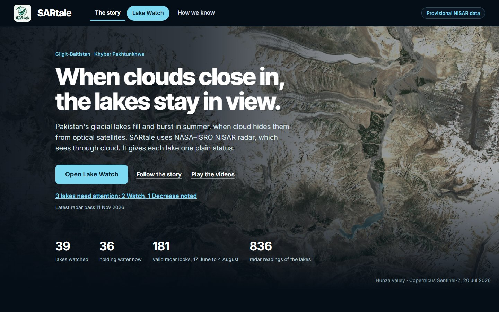
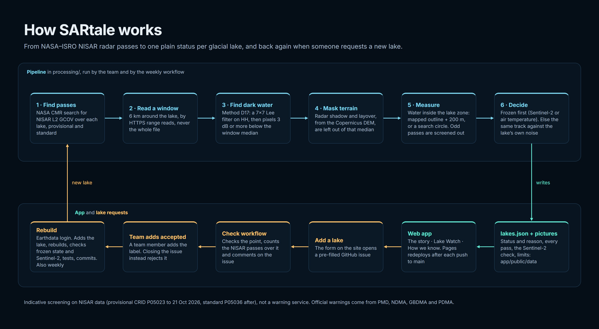

<p align="center">
  
</p>

<h1 align="center">SARtale</h1>

<p align="center">
  <b>When clouds close in, the lakes stay in view.</b><br/>
  Glacial lakes in Gilgit-Baltistan and upper Khyber Pakhtunkhwa, watched through cloud with NASA–ISRO NISAR radar.
</p>

<p align="center">
  NASA Space Apps Challenge 2026 · <i>Dancing with the SARs</i> · Islamabad local event<br/>
  Team <b>SARcastic Scientists</b>: Saeed Ahmad, Shaharyar Sajid, Usama Hussain
</p>

<p align="center">
  <a href="https://saeedahmad.me/SARtale/#videos"><b>Watch the videos</b></a>: demo (38 s) and how it works (3 min 41 s) ·
  <a href="https://saeedahmad.me/SARtale/"><b>Live site</b></a> ·
  <a href="https://saeedahmad.me/SARtale/guide/"><b>Guide</b></a>
</p>



Both videos play on the [site](https://saeedahmad.me/SARtale/#videos) and in the [guide](https://saeedahmad.me/SARtale/guide/#videos), with captions. The files are [`media/SARtale-lake-watch-demo.mp4`](media/SARtale-lake-watch-demo.mp4) and [`media/SARtale-how-it-works.mp4`](media/SARtale-how-it-works.mp4).

## Why

Over 3,000 glacial lakes have developed in Gilgit-Baltistan and Khyber Pakhtunkhwa ([UNDP GLOF-II](https://www.undp.org/sites/g/files/zskgke326/files/2023-04/GLOF%20II%20Project%20%28Dec%202022%29_Project%20Brief_2023.pdf)), and SUPARCO tracks 131 of them as potentially dangerous, mostly with optical satellites. The lakes fill in summer, and summer brings cloud. SUPARCO's [2 July 2026 update](https://space4climate.gov.pk/glof-status-update/) says:

> "Persistent cloud cover after 16 June 2026 has limited the availability of cloud-free satellite imagery, making it difficult to accurately assess lake area changes during the last three to four days."

Radar sees through cloud, day or night. From 17 June to 4 August 2026, while cloud limited the optical checks, NISAR kept looking at the watched lakes; the site gives the count of valid looks from the current data.

## What it does

- **Gives each watched lake one plain level:** No change, Watch (one pass beyond twice the lake's own noise), Alert: growing (two passes in a row growing), or Decrease noted (two in a row falling; information only). Every Watch, Alert and Decrease noted carries a short initial message: what changed, how sure, what it is not, and what to do (check recent optical imagery or the site, contact GBDMA or PDMA). A lake with no level says why: Frozen (likely), Frozen (seen by Sentinel-2), Break-up likely, Not seen this pass, Not observable, Not measurable, Not yet validated against Sentinel-2, Not enough NISAR looks yet, or No lake now (a site, such as a drained ice-dammed lake's basin, with no lake in recent imagery, kept to watch for a lake forming), which becomes Lake may be forming when a clear, snow-free Sentinel-2 view shows water there (the SARtale team then reviews the site to add it as a measured lake). The site shows the current status of each.
- **Says when a lake is probably frozen.** L-band radar cannot tell new ice from open water, and frozen ground around a lake reads as more water, so the frozen statuses come from NASA POWER air temperature at the lake's height (and a clear Sentinel-2 image when there is one), not from the radar area. A frozen lake gets no level; its area is shown greyed, and passes taken while it was frozen are left out of the comparison. Winter radar is untested; the rule is re-tested with late-January data.
- **Shows the evidence:** the latest radar picture with the water read from it, a chart and a table of every pass, and each pass left out, with the reason.
- **Prints a one-page brief** per lake: the message first, then dates, looks, noise and limits.
- **Takes requests for new lakes through GitHub issues.** A visitor fills in the website's form, which opens a pre-filled "Add a lake" issue (a GitHub sign-in is needed). A workflow checks the point, counts the NISAR passes over it and comments; a team member adds the `accepted` label to start the rebuild, or closes the issue to reject it. See [Lake requests](docs/guide/lake-requests.html). The repository is private for now, so only collaborators can open request issues until it is made public.


## How it works



For every lake and every NISAR pass, SARtale reads a 6 km window straight from NASA's archive. Method D17 smooths the HH speckle with a Lee filter and marks pixels whose HH is at least 3 dB darker than the window median, leaving terrain in radar shadow and layover (from the Copernicus DEM) out of that median, and measures water inside the lake's zone. It then compares each pass only with the median of earlier passes on its own track: one pass beyond twice the lake's own noise is a Watch, two in a row growing an Alert.

<!-- worked-example:start -->
For example, Attabad on 9 November 2026 held 4.43 km² on track 055A, a change of −0.01 km² against the median of its earlier passes on that track and a noise of 0.14 km² (z = −0.1), so it reads **No change** (from the lake data built 12 Nov 2026; the app shows the current numbers).
<!-- worked-example:end -->

The full method, with every constant, is in the [guide](docs/guide/method.html).

## Quick start

The app runs on the data in the repository; no NASA login is needed.

```bash
npm --prefix app install
npm --prefix app run dev          # http://localhost:5173
npm --prefix app test -- --run    # app tests, including the wording check
```

Rebuilding the data needs conda and an [Earthdata login](https://urs.earthdata.nasa.gov/) in `~/.netrc`:

```bash
conda env create -f environment.yml
cd processing
conda run -n sartale python -m sartale.run_pipeline lakes-search   # find NISAR passes over each lake
conda run -n sartale python -m sartale.run_pipeline lakes-fetch    # cache a 6 km window per pass
conda run -n sartale python -m sartale.run_pipeline lakes-build    # write app/public/data/lakes.json
conda run -n sartale pytest tests -q
```

## Guide

The developer and user guide is a small website in [`docs/guide/`](docs/guide/). It is published with the site at <https://saeedahmad.me/SARtale/guide/>; you can also open `docs/guide/index.html` in a browser.

| Page | For |
|---|---|
| [Getting started](docs/guide/getting-started.html) | Install, run and test |
| [Using the website](docs/guide/user-guide.html) | The story page, Lake Watch, statuses, Add a lake |
| [The method](docs/guide/method.html) | The six steps, noise, exclusions, constants |
| [Pipeline](docs/guide/pipeline.html) and [Data files](docs/guide/data.html) | Commands, the Attabad gate, `lakes_in.json` and `lakes.json` |
| [Web app](docs/guide/app.html) | Modules, routing, copy rules, tests |
| [Lake requests](docs/guide/lake-requests.html) | The issue flow, labels, accepting and rejecting |
| [Deploying](docs/guide/deploy.html) (with the owner setup), [Contributing](docs/guide/contributing.html), [Questions and limits](docs/guide/faq.html) | Hosting, ground rules, FAQ |

## Deploying

The site is at <https://saeedahmad.me/SARtale/>, published by `.github/workflows/deploy.yml` on every push to `main`. A weekly workflow refreshes the data, and the lake-request workflows handle issues. The owner sets up three things once, in this order, before any lake request is opened (steps in the [Deploying](docs/guide/deploy.html) page):

1. Settings → Pages → Source: **GitHub Actions**.
2. Settings → Environments → new environment `earthdata`, deployment branches limited to `main`, with the secrets `EARTHDATA_USERNAME` and `EARTHDATA_PASSWORD`; then delete the repository-level copies.
3. Actions → Lake requests → Run workflow once, to create the labels. The issue form drops labels that do not exist yet, so a request opened before this is never seen.

The default workflow permissions can stay at **Read repository contents**: every workflow declares the permissions it needs.

On a public repository GitHub pauses scheduled workflows after 60 days without activity.

## Limits

- **Indicative screening on provisional data.** Passes up to 21 Oct 2026 are NASA's provisional GCOV release (CRID `P05023`), which is not validated and will be reprocessed. Later passes are NASA's standard GCOV product (CRID `P05036`); we have no statement that it is validated, and a lake whose track spans both carries a limit because a calibration change can shift areas. A status is not a measure of volume or hazard.
- **Optical agreement is rough.** On clear days radar water is compared with Sentinel-2 water at each lake; How we know gives the overlap from the current data. Neither is a clean reference. A lake whose check overlaps under IoU 0.4 gets no level (Not measurable).
- **Zones are approximate.** Attabad and Passu are measured in their OpenStreetMap outlines and Shazore in its 2026 Sentinel-2 outline; the others in a search circle around a published coordinate. Wet shore inside the zone reads as water.
- **Drawdown is nearly invisible.** Wet sediment flats are as dark as water, so the radar sees a lake drawing down onto them at only about a tenth to a fifth of the real decrease.
- **Latency.** An Alert comes 5–12 days after a change begins in Hunza and 8–12 days in Chitral. This is slow-growth monitoring, not outburst warning.
- **Modelled rates.** False-alarm and miss rates are modelled from one season's noise, not observed: no lake grew in the 2026 data. They will be estimated again after one more season. Replayed on 2026, the levels raised no growth Alert; Attabad's September drawdown shows as Watches, where the method study's replay (without the 2% noise floor) had a Decrease noted on 10 Sep.
- **Small lakes.** Lakes below about 0.05 km² are limited by speckle.
- **Not an official warning service.** Official warnings come from PMD, NDMA, GBDMA and PDMA.

## Repository

| Path | Contents |
|---|---|
| `app/` | The website: TypeScript, Vite, MapLibre, uPlot |
| `processing/` | The Python pipeline and its tests |
| `media/` | Videos, screenshots and the workflow figure |
| `docs/` | The [guide](docs/guide/), [data sources and licences](docs/DATA_SOURCES.md), [AI tool use](docs/SI_USE.md) |

## Licence

Code: Apache License 2.0 ([LICENSE](LICENSE)). Data keep their own licences, listed in [docs/DATA_SOURCES.md](docs/DATA_SOURCES.md). Video narration and music were made with ElevenLabs.
