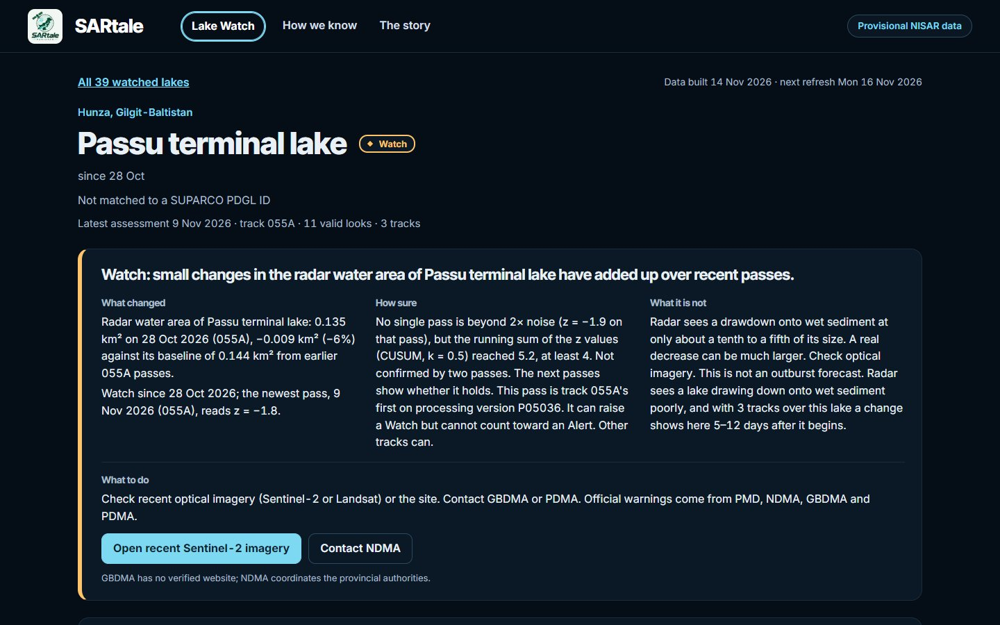
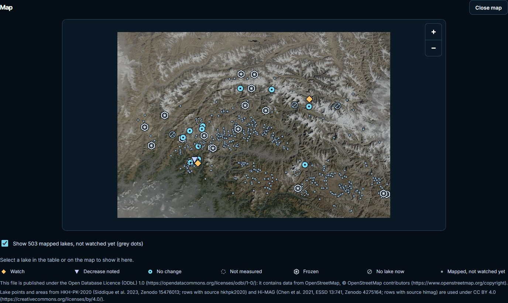

<p align="center">
  
</p>

<h1 align="center">SARtale</h1>

<p align="center">
  <b>When clouds close in, the lakes stay in view.</b><br/>
  Glacial lakes in Gilgit-Baltistan and upper Khyber Pakhtunkhwa, watched through cloud with NASA–ISRO NISAR radar.
</p>

<p align="center">
  NASA Space Apps Challenge 2026 · <i>Dancing with the SARs</i> · Islamabad local event<br/>
  Team <b>SARcastic Scientists</b>: Saeed Ahmad, Shaharyar Sajid, Usama Hussain
</p>

<p align="center">
  <a href="https://ml-dev-hub.github.io/SARtale/#videos"><b>Watch the videos</b></a>: demo (38 s) and how it works (3 min 41 s) ·
  <a href="https://ml-dev-hub.github.io/SARtale/"><b>Live site</b></a> ·
  <a href="https://ml-dev-hub.github.io/SARtale/guide/"><b>Guide</b></a>
</p>


Both videos play on the [site](https://ml-dev-hub.github.io/SARtale/#videos) and in the [guide](https://ml-dev-hub.github.io/SARtale/guide/#videos), with captions. The files are [`media/SARtale-lake-watch-demo.mp4`](media/SARtale-lake-watch-demo.mp4) and [`media/SARtale-how-it-works.mp4`](media/SARtale-how-it-works.mp4).

## Why

Over 3,000 glacial lakes have developed in Gilgit-Baltistan and Khyber Pakhtunkhwa ([UNDP GLOF-II](https://www.undp.org/sites/g/files/zskgke326/files/2023-04/GLOF%20II%20Project%20%28Dec%202022%29_Project%20Brief_2023.pdf)), and SUPARCO tracks 131 of them as potentially dangerous, mostly with optical satellites. The lakes fill in summer, and summer brings cloud. SUPARCO's [2 July 2026 update](https://space4climate.gov.pk/glof-status-update/) says:

> "Persistent cloud cover after 16 June 2026 has limited the availability of cloud-free satellite imagery, making it difficult to accurately assess lake area changes during the last three to four days."

Radar sees through cloud, day or night. From 17 June to 4 August 2026, while cloud limited the optical checks, NISAR kept looking at the watched lakes; the site gives the count of valid looks from the current data.

## What it does

The site opens on the story page, with **Open Lake Watch** as its main button. Lake Watch is a table of every watched lake for the officers at NDMA, GBDMA and PDMA KP. It now watches **39 lakes** in Gilgit-Baltistan and upper Khyber Pakhtunkhwa, with 503 more mapped lakes shown on the map as candidates.

- **One plain status per lake, with the reason on a second line.**

  | Status | Meaning |
  |---|---|
  | ▲ Alert: growing | Water area grew on two passes in a row, beyond twice the lake's own noise |
  | ◆ Watch | One pass beyond twice the noise, or small changes adding up over recent passes |
  | ▼ Decrease noted | Water area fell on two passes in a row (information only) |
  | ● No change | Within the lake's normal range |
  | ⬡ Frozen | Ice cover. The second line gives the evidence: "Seen in Sentinel-2 since …" or "By air temperature since …; no clear image" |
  | ⬡ Ice breaking up | A frozen lake whose air has been above 0 °C for a week |
  | ◌ Not measured | No usable reading; the second line says why (for example "Radar and Sentinel-2 disagree; area for information only" or "Waiting for a clear Sentinel-2 scene") |
  | ⊘ No lake now | A site, such as a drained ice-dammed lake's basin, with no water in recent imagery; it becomes **Lake may be forming** when a clear Sentinel-2 view shows water |

  A status holds until later passes clear it, and a newer pass that could not be read never hides it. Every Watch, Alert and Decrease noted carries a short message: what changed, how sure, what it is not, and what to do. Each status has its own map marker (shape, text and colour, never colour alone), and a key on the page explains them.
- **Puts the lakes that need attention first.** Count tiles (Needs attention, Open water, Frozen, Above mapped outline, No lake now, Not measured) filter the table; it can also be filtered by district or SUPARCO match, or searched by name or PDGL number. Each lake shows its radar area, its share of the largest mapped outline (Hi-MAG, HKH-PK-2020, OpenStreetMap), its recent trend and its latest pass. A phone layout has the same lists and a map.
- **Matches lakes to SUPARCO's list** by map position and area, so an officer can line SARtale up with SUPARCO's GLOF updates. SUPARCO does not publish coordinates, so the match is ours, and it is marked probable where it is not certain.
- **Says when a lake is frozen.** L-band radar cannot tell new ice from open water, so frozen lakes are found from a clear Sentinel-2 image or from NASA POWER air temperature at the lake's height, never from the radar area. A frozen lake gets no Watch or Alert, and passes taken while it was frozen are left out.
- **Shows the evidence on each lake's page:** the message, the change against the lake's baseline, its share of the largest recorded extent, the latest radar picture with the water read from it, the history chart per track, every pass left out with its reason, the limits in plain words and the sources. One button opens recent Sentinel-2 imagery and another links the official contact (NDMA for Gilgit-Baltistan, PDMA for Khyber Pakhtunkhwa).
- **Prints a one-page brief** per lake: the message first, then dates, looks, noise and limits.
- **Takes requests for new lakes through GitHub issues.** A visitor fills in the website's form, which opens a pre-filled "Add a lake" issue (a GitHub sign-in is needed). A workflow checks the point, counts the NISAR passes over it and comments; a team member adds the `accepted` label to start the rebuild, or closes the issue to reject it. See [Lake requests](docs/guide/lake-requests.html).

| A lake's page | The map |
|---|---|
|  |  |

The story page ([The story](https://ml-dev-hub.github.io/SARtale/#start)) tells why this matters, from the 2022 Shisper lake outburst to the 2026 cloud gap. **How we know** explains the method in four steps, with the technical detail in a closed section.


## How it works


For every lake and every NISAR pass, SARtale reads a 6 km window straight from NASA's archive. Method D17 smooths the HH speckle with a Lee filter and marks pixels whose HH is at least 3 dB darker than the window median, leaving terrain in radar shadow and layover (from the Copernicus DEM) out of that median, and measures water inside the lake's zone. A lake that is frozen (seen in a clear Sentinel-2 image, or by NASA POWER air temperature at its height) gets no level. Otherwise each pass is compared only with the median of earlier passes on its own track: one pass beyond twice the lake's own noise, or small changes in one direction that add up over several passes, is a Watch; two passes in a row growing are an Alert.

<!-- worked-example:start -->
For example, Attabad on 9 November 2026 held 4.43 km² on track 055A, a change of −0.01 km² against the median of its earlier passes on that track and a noise of 0.14 km² (z = −0.1), so it reads **No change** (from the lake data built 14 Nov 2026; the app shows the current numbers).
<!-- worked-example:end -->

The full method, with every constant, is in the [guide](docs/guide/method.html).

## Quick start

The app runs on the data in the repository; no NASA login is needed.

```bash
npm --prefix app install
npm --prefix app run dev          # http://localhost:5173
npm --prefix app test -- --run    # app tests, including the wording check
```

Rebuilding the data needs conda and an [Earthdata login](https://urs.earthdata.nasa.gov/) in `~/.netrc`:

```bash
conda env create -f environment.yml
cd processing
conda run -n sartale python -m sartale.run_pipeline lakes-search   # find NISAR passes over each lake
conda run -n sartale python -m sartale.run_pipeline lakes-fetch    # cache a 6 km window per pass
conda run -n sartale python -m sartale.run_pipeline lakes-build    # write app/public/data/lakes.json
conda run -n sartale python -m sartale.run_pipeline lakes-check    # compare radar water with Sentinel-2
conda run -n sartale python -m sartale.run_pipeline lakes-freeze   # frozen and break-up states (re-run after every build)
conda run -n sartale pytest tests -q
```

## Guide

The developer and user guide is a small website in [`docs/guide/`](docs/guide/). It is published with the site at <https://ml-dev-hub.github.io/SARtale/guide/>; you can also open `docs/guide/index.html` in a browser.

| Page | For |
|---|---|
| [Getting started](docs/guide/getting-started.html) | Install, run and test |
| [Using the website](docs/guide/user-guide.html) | Lake Watch, a lake's page, statuses, the story page, Add a lake |
| [The method](docs/guide/method.html) | The six steps, noise, exclusions, constants |
| [Pipeline](docs/guide/pipeline.html) and [Data files](docs/guide/data.html) | Commands, the Attabad gate, `lakes_in.json` and `lakes.json` |
| [Web app](docs/guide/app.html) | Modules, routing, copy rules, tests |
| [Lake requests](docs/guide/lake-requests.html) | The issue flow, labels, accepting and rejecting |
| [Deploying](docs/guide/deploy.html) (with the owner setup), [Contributing](docs/guide/contributing.html), [Questions and limits](docs/guide/faq.html) | Hosting, ground rules, FAQ |

## Deploying

The site is at <https://ml-dev-hub.github.io/SARtale/>, published by `.github/workflows/deploy.yml` on every push to `main`. A weekly workflow refreshes the data, and the lake-request workflows handle issues. The owner sets up three things once, in this order, before any lake request is opened (steps in the [Deploying](docs/guide/deploy.html) page):

1. Settings → Pages → Source: **GitHub Actions**.
2. Settings → Environments → new environment `earthdata`, deployment branches limited to `main`, with the secrets `EARTHDATA_USERNAME` and `EARTHDATA_PASSWORD`; then delete the repository-level copies.
3. Actions → Lake requests → Run workflow once, to create the labels. The issue form drops labels that do not exist yet, so a request opened before this is never seen.

The default workflow permissions can stay at **Read repository contents**: every workflow declares the permissions it needs.

On a public repository GitHub pauses scheduled workflows after 60 days without activity.

## Limits

- **Indicative screening on provisional data.** Passes up to 21 Oct 2026 are NASA's provisional GCOV release (CRID `P05023`), which is not validated and will be reprocessed. Later passes are NASA's standard GCOV product (CRID `P05036`); we have no statement that it is validated, and a lake whose track spans both carries a limit because a calibration change can shift areas. A status is not a measure of volume or hazard.
- **Optical agreement is rough.** On clear days radar water is compared with Sentinel-2 water at each lake; How we know gives the overlap from the current data. Neither is a clean reference. A lake whose check overlaps under IoU 0.4 is shown as Not measured with that reason; its area is for information only.
- **Zones are approximate.** Attabad and Passu are measured in their OpenStreetMap outlines and Shazore in its 2026 Sentinel-2 outline; the others in a search circle around a published coordinate. Wet shore inside the zone reads as water.
- **Drawdown is nearly invisible.** Wet sediment flats are as dark as water, so the radar sees a lake drawing down onto them at only about a tenth to a fifth of the real decrease.
- **Latency.** An Alert comes 5–12 days after a change begins in Hunza and 8–12 days in Chitral. This is slow-growth monitoring, not outburst warning.
- **Modelled rates.** False-alarm and miss rates are modelled from one season's noise, not observed: no lake grew in the 2026 data. They will be estimated again after one more season. Replayed on 2026, the levels raised no growth Alert; Attabad's September drawdown shows as Watches, where the method study's replay (without the 2% noise floor) had a Decrease noted on 10 Sep.
- **Small lakes.** Lakes below about 0.05 km² are limited by speckle.
- **Not an official warning service.** Official warnings come from PMD, NDMA, GBDMA and PDMA.

## Repository

| Path | Contents |
|---|---|
| `app/` | The website: TypeScript, Vite, MapLibre, uPlot |
| `processing/` | The Python pipeline and its tests |
| `media/` | Videos, screenshots and the workflow figure |
| `docs/` | The [guide](docs/guide/), [data sources and licences](docs/DATA_SOURCES.md), [AI tool use](docs/SI_USE.md) |

## Licence

Code: Apache License 2.0 ([LICENSE](LICENSE)). Data keep their own licences, listed in [docs/DATA_SOURCES.md](docs/DATA_SOURCES.md). Video narration and music were made with ElevenLabs.
