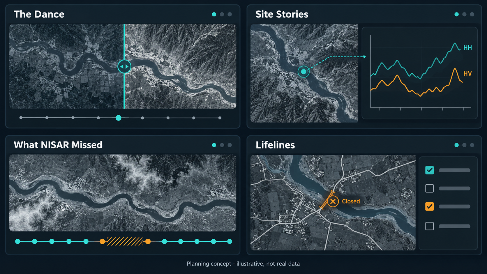

# SARtale: Hackathon Plan for "Dancing with the SARs"

NASA Space Apps Challenge, 14-15 November 2026. Plan dated 1 November 2026.

Team: **SARcastic Scientists** (Saeed Ahmad and Shaharyar Sajid), Islamabad Local Event.

This replaces the build plan in [deep-research-report.md](deep-research-report.md) for the hackathon. That report stays useful as background and for the long-term pilot. Section 12 lists what changed and why. The task-by-task build plan is in [the implementation plan](superpowers/plans/2026-11-01-sartale-hackathon.md).

## 1. The plan in brief

**Build an interactive story of one monsoon season in the Peshawar Valley, told through NISAR radar, that ends with what the changes mean for floodplain roads and bridges.**

Working title: **SARtale: One Monsoon, Seen by Radar.**

Four facts checked today shape everything else:

| Finding | Evidence | What it changes |
|---|---|---|
| **We may not start project work before the hackathon.** | FAQ: "Teams are not allowed to begin working on the challenges prior to the hackathon." The site banner repeats it. | The team chose to start on 1 Nov and accepted this risk. Disclose it. See section 3. |
| **Usable NISAR data exists over the pilot.** | NASA's catalogue returns 63 GCOV files in our search box. Track 84A frame 19 covers all of it, in one consistent mode, on 9 dates so far. | The biggest open question in the old plan is closed. See section 5. |
| **No flood capture is established in NISAR data here.** | One FFD bulletin suggests a low 2026 peak on the Kabul at Nowshera (about 78,500 cusecs against a 391,300 record). A low flood was reported on 27 July, with rain forecast to 29 July. The last full-coverage pass before the gap was 26 July, and the next was 12 August. | The app must not claim to detect a flood. Seasonal change is the safer story, and it is what the challenge asks for. PDMA reports still need checking. |
| **The 2025 flood maps cannot validate NISAR.** | UNOSAT and FAO mapped 2025. Calibrated NISAR data starts 17 June 2026. | They become historical context only. Validation uses same-season OPERA and HLS data. See section 9. |

The old plan's main idea survives: separate what was observed from what is inferred, and never call exposure "damage". What changes is the emphasis. The old plan was a flood-resilience platform that happens to use NISAR. This plan is a NISAR surface-change app that ends in a resilience use case, because that is what the challenge statement describes.

## 2. What the competition asks for

### The challenge statement

Source: [Dancing with the SARs](https://www.spaceappschallenge.org/2026/challenges/dancing-with-the-sars/).

The core ask: "build an interactive application that uses radar remote sensing data from the NASA-ISRO Synthetic Aperture Radar (NISAR) mission to track and visualize one or more types of surface change at locations around the world."

| The statement asks for | How SARtale answers it |
|---|---|
| Interactive application using NISAR data | Web app built on a NISAR HH/HV time series |
| Track and visualize surface change | Date slider, before/after swipe, seasonal colour composite |
| "open-source, user-friendly" and "actionable insights" | Public repo, plain-language cards, a printable field-check list |
| Make NISAR "accessible to a broad audience" | Story mode for anyone; site explorer for specialists |
| Pick a study area, hometown suggested | Peshawar Valley, with personal context if a team member has it (open question 4) |
| Supplemental data for context | OPERA water, HLS optical, rainfall, roads, population |
| "Hypothesize the physical drivers behind what you see (or don't see)" | A hypothesis card per site, including a "what NISAR did not see" card |
| "Which polarizations highlight these changes" | HH versus HV comparison per site |
| "What future applications of NISAR are possible?" | A closing section on what continuous 12-day coverage could do for flood preparedness |

**Optional ideas in the statement:** time series, ancillary data, human drivers (farming, here), compelling storytelling, and personal stories.

### Confirmed rules

| Rule | Value | Source |
|---|---|---|
| Dates | 14-15 Nov 2026 | [FAQ](https://www.spaceappschallenge.org/resources/participant-faqs/) |
| Deadlines | Pitch materials **17:00 PKT**, live pitch **18:30 PKT**, global portal **23:59 PKT**, all on 15 Nov | [Islamabad event](https://www.spaceappschallenge.org/2026/local-events/islamabad/) |
| Start | Check-in 09:00, hacking 11:00 PKT on 14 Nov | Islamabad event |
| Team size | Max 6. Local Event min 1, Universal Event min 2. One team, one challenge. | FAQ |
| Where to submit | The team's project page on spaceappschallenge.org | FAQ |
| AI tools | Allowed. The submission "must include a description of how SI tools were used". NASA's term is Super Intelligence (SI). | FAQ |
| Licensing | Original content must be freely available or OSI open source. The default is Apache 2.0. | [Terms](https://www.spaceappschallenge.org/legal/) |
| Non-NASA data and code | We must confirm it is freely and publicly available or open source, and identify the licences. | Terms |
| Banned content | Personal data, proprietary material, commercial promotion. Avoid names, voices and likenesses of under-18s. | Terms |

### Not published yet

These arrive on **13 November**: the [challenge resources](https://www.spaceappschallenge.org/2026/challenges/dancing-with-the-sars/?tab=resources), the Project Submission Guide, and the Judging and Awards Guide. Space Apps Connect opens 3 November.

So the **official 2026 demo format and video length are unknown**. Do not build around remembered rules from earlier years. Re-read this plan against all three documents on 13 November.

### Islamabad specifics

Source: [Islamabad event page](https://www.spaceappschallenge.org/2026/local-events/islamabad/).

- **Local Lead:** Abdullah Zafar.
- **Format:** virtual and in-person. The venue was not listed on the page when checked.
- **Extra deliverable:** a pitch deck for local judges, plus a live pitch to the panel.
- **Mentors:** on-site mentors and a Saturday mentor briefing.
- **Team size:** 1 to 6.
- **Judging criteria:** the Seoul site listed impact, creativity, validity, relevance and presentation. Islamabad did not state them on the part of the page read. Confirm in NASA's guide on 13 Nov.

The 2025 award categories were: Best Use of Data, Best Use of Technology, Galactic Impact, Best Mission Concept, Most Inspirational, Best Use of Storytelling, Global Connection, Art & Technology, and Local Impact. This plan best fits **Best Use of Data, Best Use of Storytelling and Local Impact**, if those return in 2026.

## 3. Staying inside the "no early work" rule

NASA's rule stands: "Teams are not allowed to begin working on the challenges prior to the hackathon." The team decided on 1 Nov to start building early and accepted that risk. Ask the Islamabad Local Lead what must be disclosed, and keep the reply.

The list below is my reading of the rule, not an official one.

| Likely fine before 14 Nov | Ask first | Wait until the event starts |
|---|---|---|
| Registering, joining an event, forming a team, and agreeing roles and a build plan | Keeping detailed task lists and sharing them | Writing project code or notebooks |
| Reading the challenge statement and NISAR documentation | Metadata-only catalogue searches like those in section 5 | Downloading or processing pilot NISAR data |
| Learning SAR basics and general tools | Contacting PDMA, NDMA or district officials about the project | Designing screens, logos or project media |
| Creating an Earthdata Login and accepting the ASF terms | Using a concept mockup such as the one in section 7 as anything other than a planning aid | Preparing demo packages or precomputed outputs |
| Installing general-purpose software | | Creating the project repo with project content |

**What exists already:** public pages were read, metadata searches were run, and this detailed plan and a concept image were created. No NISAR data was downloaded and no project code was written. Under a strict reading, even this plan and image could count as early work.

So **tell the Local Lead exactly what exists, and get written guidance before doing more project-specific preparation or reusing any of it.** Calling something a planning aid does not make it compliant. If they object, follow their instruction, which may mean discarding these documents.

**This also overrides the old plan's "offline demo package".** It is a good idea, but it has to be built during the event.

## 4. Who it serves and the story

**Primary audience: Islamabad local judges, then global judges and the public.** They need to understand NISAR within a minute. Keep all submitted material in English.

**Secondary audience: district planners and NGOs in KP.** They are the reason the end of the story matters, but we have not spoken to any. Do not claim real-world validation.

### The story, in six beats

1. **Hook.** The Kabul River valley floods again and again, most recently in 2025. Satellites usually show up after the disaster.
2. **Meet NISAR.** Radar sees through monsoon cloud and returns every 12 days.
3. **The dance.** Play the season from 26 July (the first of the four default dates: 26 Jul, 19 Aug, 12 Sep, 18 Oct) to the latest date. 2 July and 14 July carry cautions and stay out of the default set. Farmland pulses, river bars emerge and vanish, the city stays still.
4. **Why it moved.** Tap a site for HH and HV curves and a stated hypothesis. HH and HV respond differently, and the app shows how.
5. **What NISAR did not see.** No full-coverage pass happened between 26 July and 12 August, partly because of a permanent data gap. Whatever peaked in that window went unobserved, and showing that builds trust. Confirm event timing before stating this.
6. **Why it matters.** Show one decision linked to evidence: a crossing beside a river stretch that NISAR saw change, inside the 2025 flood outline, with few alternatives if closed. If no such link appears in the data, end on the strongest surface-change story instead.

## 5. Verified data (metadata checked 1 Nov 2026)

All of this came from NASA's public CMR catalogue for `NISAR_L2_GCOV_PROVISIONAL_V1`. **Repeat the search on 14 Nov**, because it may have changed. Actual pixel quality is unchecked until the data is opened.

### Which tracks actually cover the pilot

The bounding-box search returned 63 files, but most barely touch the pilot. Coverage below was computed from the file footprints against a working box of 71.4-72.1°E, 33.9-34.4°N.

| Stack | Direction | Pilot coverage | Files | Modes | Verdict |
|---|---|---|---|---|---|
| **084 A 019** | Ascending | **100%** | 9 | All 40+5 MHz, HH/HV | **Primary** |
| **012 A 019** | Ascending | 99% | 9 | All 40+5 MHz, HH/HV | Secondary; 5 days offset |
| 164 D 071 | Descending | 100% | 10 | Mixed: 6 dual-pol, 4 quad-pol | Use only the same-mode subset |
| 012 A 018 | Ascending | 10% | 9 | Dual-pol | Not useful |
| 063 D 071 / 072 | Descending | 4% | 10 / 15 | Mixed | Not useful |
| 164 D 072 | Descending | 0% | 1 | Dual-pol | Not useful |

Accuracy flags matter too: track 84's 14 July granule is marked as forecast-orbit (`F`), so leave it out of the first four dates.

Stack 084 A 019 also contains Peshawar, Nowshera, Charsadda, Mardan, Swabi, Swat (Mingora), Lower Dir, Malakand and Buner. **The old plan's fallback areas are already in the same files**, so moving the area of interest costs no extra download.

### Primary stack dates

| Track | Pre-gap | Permanent gap | Post-gap |
|---|---|---|---|
| **084 A 019** (about 05:22 Pakistan time) | 2, 14, 26 Jul | no data, 27 Jul to 10 Aug | 19, 31 Aug; 12, 24 Sep; 6, 18 Oct |
| 012 A 019 (about 05:30 Pakistan time) | 27 Jun; 9, 21 Jul | no data, 27 Jul to 10 Aug | 14, 26 Aug; 7, 19 Sep; 1, 13 Oct |

- **Pixel spacing:** 10 m at Frequency A (40 MHz), per the [GCOV spec](https://nisar-docs.asf.alaska.edu/gcov/). The 5 MHz Frequency B product is 80 m.
- **File size:** about 7.3 GB each, so roughly 66 GB for the 084 stack if whole files are needed. That is about 7 hours at a sustained 20 Mbps, so start with four dates. `I:` has 749 GB free. `C:` has only 43 GB, so keep data on `I:`.
- **Possible newer dates:** a 12-day pattern suggests 30 Oct and 11 Nov on track 84. Do not rely on them, given the pause below.

### First look at real scenes (1 Nov 2026)

NASA's browse images are public, so all 9 track 84 dates were checked without a login. They are low-resolution previews, not science data, so this is a first look only.

- **2 July looks unusable over the western pilot.** A bright green haze covers roughly the Peshawar-Charsadda area. It is absent on the other 8 dates and in a control area further north. It may be radio interference, but that is unconfirmed until HV pixels are inspected. **Do not treat it as surface change.**
- **The other 8 dates look clean at this scale.** Rivers, reservoirs and the bright Peshawar urban area are visible.
- **Default first four dates:** 26 Jul, 19 Aug, 12 Sep and 18 Oct.
- **Possible story:** the interference question itself fits the "What NISAR Missed" view, once confirmed.

NASA's [sample data](https://science.nasa.gov/mission/nisar/sample-data/) includes two public GCOV files from 2008 over a different area. They were used only to test the file reader, and they confirmed the coordinate, projection and looks layout. They are single-pol files with no HV term, and their mask holds only 0 and 255, so they cannot confirm what the mask values mean on a real file or that the HV term reads correctly. They are older product versions and should not appear as project results. The real `P05023` files, including HV and the mask, are unread until the first real run (the Earthdata login now works).

### Data status warnings

- **Production pause:** provisional production [paused on 23 Oct](https://www.earthdata.nasa.gov/data/alerts-outages/nisar-provisional-data-product-production-paused) for a software upgrade. Processing is expected to resume after 4 Nov, then catch up within days. This explains why the catalogue currently stops at 23 Oct.
- **Version pinning:** the [availability page](https://nisar-docs.asf.alaska.edu/availability-overview/) says validated reprocessing is expected in Q4 2026. Use one CRID only, `P05023` as of today, and never mix versions in a time series.
- **Single-track rule:** only compare dates within one stack. Tracks 84 and 12 look at the ground from different angles, so a difference between them is not surface change.
- **Maturity label:** show "Provisional" on every NISAR layer. Do not combine it with BETA data, though BETA GCOV does exist over the pilot for Nov 2025 to Jan 2026. Pre-release calibration differs, as ASF warns.
- **Radio interference:** the [known issues page](https://nisar-docs.asf.alaska.edu/provisional-known-issues/) warns that interference filtering can leave residuals or remove real features. Inspect each date by eye before using it.

### Supporting data

| Dataset | Status over the pilot | Use | Evidence type |
|---|---|---|---|
| OPERA DSWx-S1 | 71 catalogue hits, 17 Jun to 1 Nov 2026 | Same-season water check | Independent reference |
| OPERA DSWx-HLS | 387 hits, same window | Optical water check, cloud permitting | Independent reference |
| HLS (Landsat + Sentinel-2) | Not yet checked | Crop and vegetation check | Independent reference |
| NISAR SME2 soil moisture | 42 hits. ASF says not yet fully calibrated. | Stretch goal only | Experimental |
| GPM IMERG | Not yet checked | Rain timing chart, about 10 km grid | Context |
| UNOSAT Aug 2025 flood map | Not yet downloaded | Historical flood outline. Preliminary and not field-validated. | Historical context |
| OpenStreetMap | Not yet checked for this area | Roads, bridges, hospitals, schools | Context, completeness varies |
| WorldPop | Not yet checked | Rough population near road links | Modelled estimate |
| HydroRIVERS / HydroBASINS | Not yet checked | River and catchment context | Context |

**Licence check:** the Terms make us responsible for each non-NASA source. Confirm UNOSAT, WorldPop and HydroSHEDS terms during the event, and record OpenStreetMap's ODbL attribution. Leave out KP C&W, PDMA and PMD data unless the licence clearly allows open redistribution. Link to official warnings rather than republishing them.

## 6. Science approach

Keep it simple enough to explain to a judge in a sentence.

### Processing

1. Search, then record each granule ID, track, frame, mode, CRID and checksum in a manifest.
2. Read `HHHH` and `HVHV` for Frequency A, plus `numberOfLooks` and `mask`.
3. Clip to the study area. Confirm the 9 dates share one grid; reproject only if they do not.
4. Mask fill, non-finite and non-positive values. Average the **linear** gamma-0 power to about 30-40 m, then convert to decibels. Order matters: averaging decibels gives a different, biased result. GCOV is already multilooked, so this trades resolution for stability.
5. Compute per-pixel statistics: mean, standard deviation, and change between chosen dates.
6. Build a seasonal colour composite from one polarization (red early, green mid, blue late), using one shared display stretch. Stable land then appears roughly grey, though speckle can still add colour. Label colour as a backscatter difference, not proven physical change.
7. Sample curves at named sites: three strong ones first, more only if time allows.
8. Compare with OPERA water and HLS vegetation at the closest dates.

**Do not assume a ready-made quality flag.** The GCOV spec describes `mask` as information about the radar samples behind each pixel, not a simple pass/fail map. The old plan's four-state quality mask needs to be built from these layers and terrain, and is only worth doing if time allows. For a floodplain pilot, a single "low confidence" mask for steep slopes is enough.

The log-ratio from the old plan stays as the formula for date-to-date change:

```text
change_dB = 10 * log10( P_later / P_earlier )
```

This measures **change in radar backscatter**, not flood probability.

### Hypotheses to test, not conclusions

| Pattern | Possible driver | How to test |
|---|---|---|
| Low in both HH and HV, stable | Permanent open water | DSWx agrees |
| Low, then brighter by October | Water left, wet sediment or bar exposed | DSWx and HLS show the change |
| HV rises through the season | Crop or plant volume growing | HLS vegetation rises at the same site |
| Sudden fall in both after peak season | Harvest or field clearing | HLS falls; local crop calendar |
| Temporary HH rise, little HV change | Wetter or rougher soil, or irrigation | IMERG rain timing; irrigated versus rain-fed area |
| High HH with moderate HV in a wet period | Possibly flooded vegetation | Hard to confirm; label as uncertain |
| Bright and stable | Buildings; the stable control | Should stay flat through the season |

Crop timing and irrigation practice in the valley must be confirmed by someone local. L-band also penetrates small crops, so the signal over short crops may be weak. If so, report that as a finding.

**Language rules:** use "may indicate", never "detected flood". Keep the old plan's ladder: observed change, possible exposure, suspected impact, confirmed damage. Only the first two appear in the hackathon build, because we will have no field evidence. "Scenario-disconnected" is allowed; "isolated" is not.

## 7. What gets built



*Planning concept only. It contains illustrative content, not real results. See section 3 before reusing it.*

### Four views

| View | Purpose | Priority |
|---|---|---|
| **The Dance** | Map with date slider, animation, HH/HV toggle, before/after swipe, seasonal composite | Must |
| **Site Stories** | 3 strong sites first, up to about 10 if time allows. Tap for curves, hypothesis, evidence status, and limits | Must |
| **What NISAR Missed** | Coverage timeline showing the data gap and what went unobserved | Must |
| **Lifelines** | Close a bridge or road and see what loses access to a hospital. Export a printable check-first list. | Stretch |

Every claim on screen shows its dates, data source, processing version and evidence type. This is the old plan's evidence card, kept light.

### Build in tiers

**Tier 1, the first complete submission:** four dates, HH and HV, three strong sites, The Dance, Site Stories and What NISAR Missed. Reach this before anything else.

**Tier 2:** the remaining dates, more sites, then Lifelines.

### Cut list

If behind schedule, cut in this order, top first:

1. Soil moisture layer
2. Urdu labels
3. Second track (012 A)
4. WorldPop numbers
5. Printable brief; keep an on-screen list
6. Live road closure; keep 3 precomputed scenarios
7. Lifelines view entirely

**Never cut:** real NISAR time series, HH/HV comparison, stable-site check, evidence labels, source and licence list, or SI-use statement.

### Not building for the hackathon

Action register, user accounts, PostGIS, provenance database, flood prediction, risk scores, damage estimates, official warnings, nationwide coverage, or machine learning.

### Architecture

The old stack (FastAPI, TiTiler, PostGIS) needs a running server and is more than the event needs. Use a static site with one image per date, which suits a two-person team better than tiled maps.

```text
ASF NISAR GCOV (HDF5)
   |  Python: h5py, numpy, rasterio, GDAL
   v
Cloud Optimized GeoTIFFs (open data outputs)
   |
   +--> one WebP overlay per date and polarization, at 30 m
   +--> manifest.json and sites.json
   +--> scenarios.json (Tier 2 only)
   v
Static web app: MapLibre + uPlot, with local river and road GeoJSON
```

- **Why image overlays:** the study area fits in a few images of about 2,000 pixels across, so tiling adds work without adding much. They also avoid the Range-request and CORS issues PMTiles would need checked.
- **Why static:** fewer moving parts, no running cost, and no server to fail during judging. It does not remove risk, so test the deployed site.
- **Offline backup:** bundle all libraries and local GeoJSON, with no outside map tiles.
- **Click-anywhere curves:** dropped for the hackathon. Site curves carry the story.
- **Road analysis:** OSMnx and NetworkX in Python, run ahead and saved as JSON.
- **Environment:** rasterio, h5py and GDAL are not installed on this machine. Use a conda-forge environment, installed before the event as general tool setup.
- **Download method:** ASF search plus either full-file download or Harmony layer extraction. Try extraction first; if it fails within 20 minutes, download whole files. The old plan's Harmony claims were not re-verified.

## 8. Event schedule

This assumes 2 people. There are 30 hours from the 11:00 start to the 17:00 Sunday pitch deadline, with a further 7 hours to the portal deadline. Times are Pakistan time (PKT).

| PKT | Person A: data and science | Person B: app and story | Gate |
|---|---|---|---|
| Fri 13 Nov | Read challenge resources | Read submission and judging guides | Changes noted |
| Sat 09:00-11:00 | Check-in, opening, mentor briefing | Same | Mentors know the project |
| Sat 11:00-13:30 | Rerun catalogue search; start downloads | Check real manifest in the app; open project page | **Gate 1:** data is downloading |
| Sat 13:30-18:30 | Read one file; fix reader if the layout differs; inspect pixels | Replace demo data as frames arrive | **Gate 2:** first real NISAR image on the map |
| Sat 18:30-Sun 00:00 | Four dates, overlays, composite, three sites | Site cards from real curves | **Gate 3:** four-date series in the app |
| Sun 00:00-09:00 | Stable control, OPERA and HLS checks; sleep in turns | Real copy; sleep in turns | **Gate 4:** Tier 1 works end to end |
| Sun 09:15-13:00 | Tier 2 only if Tier 1 is solid | Pitch deck; demo recording | **Gate 5:** features stop at 13:00 |
| Sun 13:00-16:00 | Clean rerun; recheck numbers | Pitch rehearsal; offline and phone test | Freeze |
| Sun 16:00 | Submit pitch deck and materials | Same | About 1 hour early |
| Sun 18:30-19:30 | Live pitch to local judges | Same | |
| Sun 21:30 | Final portal submission | Same | **Well before 23:59 PKT** |

### If a gate fails

| Gate | Fallback |
|---|---|
| 1. Data cannot be reached | Check [ASF status and the Earthdata alert](https://www.earthdata.nasa.gov/data/alerts-outages/nisar-provisional-data-product-production-paused); try Earthdata Search, then Harmony; ask on Connect. |
| 2. Files or tools fail | Move one member to a single-file notebook using `h5py`. The target is one date on a map. |
| 3. Dates do not align or are noisy | Reduce to 4 clean dates and a smaller area. A short honest series beats a long doubtful one. |
| 4. Stable sites drift badly | Stop interpreting that date; flag as provisional or drop it. Investigate before adding features. |
| 4. Change is too weak to show | Report the weak signal honestly and choose better floodplain sites. Move to Swat or Buner only before hour 12, because mountains add terrain checks. |
| 5. Road data is poor | Drop to precomputed closures on a small verified set, or cut Lifelines. |

### Roles

| Role | Owns |
|---|---|
| Person A: data and science | NISAR processing, quality, reference checks, hypotheses, road analysis |
| Person B: app and story | App, map, charts, narrative, demo, project page, licences, SI statement |

Each person reviews the other's work at every gate. **A third member**, if you add one, should cover design and story. The team page is open and the limit is 6.

## 9. Validation

Validate only against data from the same season. The hackathon results are a prototype check, not a scientific validation.

| Check | Reference | What to report |
|---|---|---|
| Radiometric stability | Bright urban sites and other stable controls | Spread of dB across dates, per polarization |
| Geolocation | River banks, roads, bridges | Visual offset against optical imagery |
| Water behaviour | DSWx-S1 and DSWx-HLS at the nearest date | Agreement over permanent and seasonal water; time difference shown |
| Vegetation behaviour | HLS vegetation index at crop sites | Whether curves move together, or why not |
| Road analysis | Manual route check on 3 closures | Whether the path change makes sense |
| Reproducibility | Clean rerun from the manifest | Matching outputs, or a stated tolerance |
| Understanding | One person outside the team | Can they tell observation from inference within a minute? |

Set the water comparison up carefully: the OPERA layers have 30 m pixels and are Sentinel-based, so dates will not match exactly. **There is no pass mark for these checks.** State the numbers, the sample and the limits.

## 10. Submission checklist

Replace this with the official list on 13 November.

- [ ] Pitch deck submitted by 17:00 PKT and live pitch rehearsed
- [ ] Project page complete on spaceappschallenge.org by 23:59 PKT
- [ ] Public open-source repo with a licence (Apache 2.0 unless the team prefers another OSI licence)
- [ ] Working app link, plus an offline backup
- [ ] Demo media in the 2026 required format
- [ ] All NASA and partner data listed, including granule IDs
- [ ] All non-NASA data and code listed with licences
- [ ] SI tool use described, including code, writing and images
- [ ] No personal data; no recognisable under-18s; adults' consent for any likeness
- [ ] "Provisional NISAR data" and "not an official warning service" stated in the app
- [ ] Team publishes the app and repo itself at submission time

## 11. Main risks

| Risk | Likelihood | Impact | Response |
|---|---|---|---|
| Pre-event work breaks the rule | Medium | Severe | Section 3; Local Lead reply in writing |
| New data or reprocessing changes the archive mid-event | Medium | Medium | Pin one CRID; save the manifest at hour 0 |
| Download is slow | Medium | High | Start at 08:00; begin with four dates; extract layers if possible |
| Pitch deadline is missed by building too late | Medium | Severe | Features stop at 13:00; submit pitch materials by 16:00 |
| One of two people is unavailable or blocked | Medium | High | Tier 1 first; shared repo; gates reviewed together |
| Seasonal signal is weak or hard to explain | Medium | High | Choose varied floodplain sites; report honestly |
| Radar change gets read as flood or damage | High | High | Language rules in section 6 |
| Interference or provisional artefacts look like real change | Medium | High | Inspect each date; check stable controls |
| OpenStreetMap roads are incomplete | Medium | Medium | Use precomputed cases; label as a demonstration |
| Mistaken for an official warning tool | Medium | High | Clear disclaimer; link to PMD and PDMA; change "early-warning tool" on the team page |
| Scope grows back | High | High | Follow the cut list and gates |

## 12. What changed from the original report

**Replaced or corrected**

| Original | Now | Why |
|---|---|---|
| Disaster-management platform | NISAR surface-change story with a resilience ending | Matches the challenge statement |
| Prepare data before the event | Nothing project-specific before 14 Nov | Official rule |
| Granules unverified | Coverage and dates confirmed from the catalogue | Checked today |
| Validate with UNOSAT and FAO | Same-season OPERA and HLS | Different years cannot validate each other |
| Flood classification with six evidence states | Hypothesis cards tied to observed patterns | No flood capture is established |
| Fixed 36-hour schedule ending at 11:59 p.m. | Islamabad schedule for two people, with a pitch at 18:30 | Islamabad event page |
| FastAPI, TiTiler, PostGIS, object storage | Static site with image overlays | Less to fail; suits two people |
| Valid-data mask assumed available | Quality handling to be built and checked | GCOV spec |
| `citeturn` markers | Plain links | Citations were unreadable |

**Added:** polarization analysis, physical-driver hypotheses, the "what NISAR did not see" section, future applications, SI disclosure, and licence duties.

**Moved to after the hackathon:** action register, Urdu and Pashto interfaces, government data, field verification, stakeholder pilot, budgets, and the 6-12 month roadmap. See sections "Delivery plan" and "Governance" of the original report. Those budgets are planning estimates and were not re-checked.

**Kept:** the evidence hierarchy, the "exposure is not damage" principle, complementing PMD, PDMA and NDMA rather than competing with them, and the Peshawar-Charsadda-Nowshera study area.

## 13. Sources

Islamabad: [event page](https://www.spaceappschallenge.org/2026/local-events/islamabad/). Seoul criteria source: [Seoul site](https://nasaspaceappskr.org/2026/en/).

Space Apps: [challenge statement](https://www.spaceappschallenge.org/2026/challenges/dancing-with-the-sars/), [FAQ](https://www.spaceappschallenge.org/resources/participant-faqs/), [Terms](https://www.spaceappschallenge.org/legal/), [2025 awards](https://www.spaceappschallenge.org/2025/awards/).

NISAR: [availability](https://nisar-docs.asf.alaska.edu/availability-overview/), [GCOV](https://nisar-docs.asf.alaska.edu/gcov/), [known issues](https://nisar-docs.asf.alaska.edu/provisional-known-issues/), [production pause alert](https://www.earthdata.nasa.gov/data/alerts-outages/nisar-provisional-data-product-production-paused), [CMR granule search](https://cmr.earthdata.nasa.gov/search/granules.umm_json?short_name=NISAR_L2_GCOV_PROVISIONAL_V1&bounding_box=71.3,33.8,72.2,34.5&page_size=200&sort_key=start_date).

2026 flood context: [FFD bulletin, 6 Sep 2026](https://ffd.pmd.gov.pk/b/0729b315-6fbb-4422-afdb-241fec938528), [The Nation, 27 Jul 2026](https://www.nation.com.pk/27-Jul-2026/fresh-spell-rainfall-increases-water-flows-kabul-indus-rivers-across-kp), [24 News, 18 Aug 2026](https://www.24newshd.tv/18-Aug-2026/ndma-warns-flash-floods-glofs-landslides-monsoon-rains-persist), [Arab News, Sep 2026](https://www.arabnews.pk/pakistan/pakistan-warns-of-fresh-floods-as-monsoon-death-toll-reaches-180-3000233).

**Confidence note:** the 78,500 cusecs figure comes from one bulletin row, read without its column header in view, and the date of that peak is unknown. Search found no major 2026 flood in the pilot, but PDMA situation reports were not reviewed, so this is unproven. Check them during the event: a local flood on a date NISAR covered would be a strong addition to the story.

**Independent review:** Codex reviewed this plan, and its findings on SAR processing, sizing, feasibility and rule risk have been applied. Codex could not retrieve the official FAQ itself.
