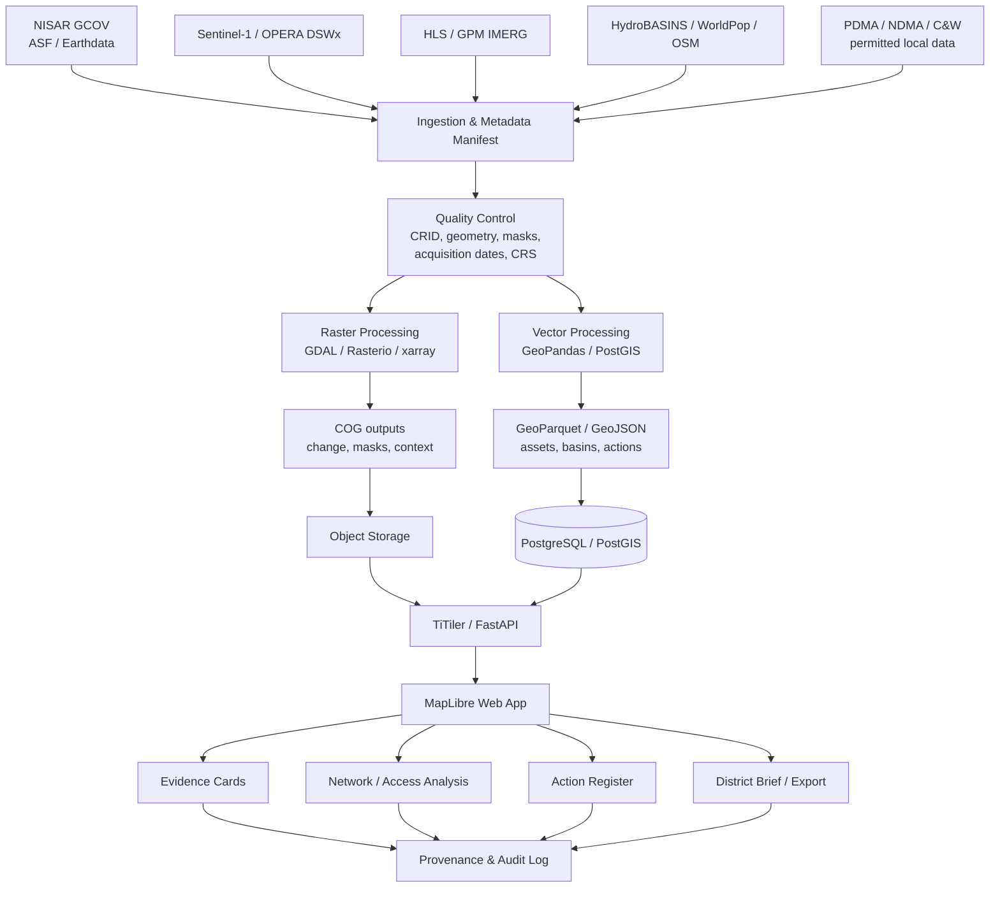
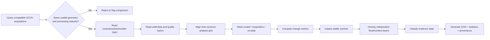

iturn729205image4turn729205image0turn729205image6turn729205image8

# SARtale Pakistan: Actionable Build Plan for a NISAR-Centered Flood-Resilience Planning Platform

## Executive summary

**SARtale Pakistan should be built as a decision-support and coordination platform, not as another flood map and not as a replacement for Pakistan's official warning systems.** Its core job should be to help district governments, PDMA/NDMA, infrastructure departments, NGOs, and environmental specialists answer a practical question:

> **Which communities, roads, bridges, services, and environmental systems are becoming more vulnerable to flooding; what evidence supports that conclusion; what remains uncertain; and what action should be investigated or prioritized?**

This positioning fits the 2026 NASA Space Apps **Dancing with the SARs** challenge because the challenge specifically asks teams to create an interactive application using NISAR radar observations to track and communicate surface change. The global event is scheduled for **November 14–15, 2026**, with project submission closing at 11:59 p.m. local time on November 15. citeturn265454search1turn265454search2

Khyber Pakhtunkhwa is a defensible first region. NDMA's 2025 infrastructure advisory identified Chitral, Swat, Shangla, Buner, Torghar, Khyber, Peshawar, Charsadda, Nowshera, D.I. Khan, and Tank among KP districts considered most at risk from flood-related infrastructure losses, while specifically noting major road and bridge disruption in previous floods. citeturn467268search8 PDMA KP already has district-level disaster-management responsibilities and a Provincial Emergency Operations Center designed to coordinate provincial departments and district administrations, so SARtale should be designed to complement those workflows rather than invent a parallel operational chain. citeturn467268search3turn815825search4

The recommended **initial pilot is the Charsadda–Nowshera–Peshawar corridor, with the lower Swat/Kabul catchment represented upstream**, because it combines riverine flood exposure, major transport links, population centers, existing UNOSAT reference mapping, and direct relevance to PDMA and district-government workflows. UNOSAT mapped approximately 35 km² of apparent floodwater in Charsadda, Nowshera, and Peshawar on August 20, 2025, with roughly 41,000 people potentially exposed or near flooded areas; UNOSAT explicitly labels this as preliminary and not field-validated, making it useful reference evidence rather than unquestioned ground truth. citeturn361053search6 A second northern pilot around **Swat–Lower Dir–Malakand** should be maintained as a fallback or mountain-hazard extension; UNOSAT mapped roughly 40 km² of apparent floodwater there on July 1, 2025. citeturn361053search7

The most important technical constraint is NISAR availability. Public **PROVISIONAL L-band products are available for acquisitions beginning June 17, 2026**, with GCOV available as `NISAR_L2_GCOV_PROVISIONAL_V1`. The products are fully calibrated but only partially validated, and ASF warns that they remain provisional. There is also a permanent instrument-data gap from July 27 to August 10, 2026 UTC. citeturn361053search0turn361053search4 GCOV is nevertheless an excellent hackathon product because it provides terrain-corrected gamma-0 backscatter on a geocoded 10- or 20-meter grid and can be used directly in GIS-style analysis. citeturn361053search3

**Exact NISAR granule IDs covering the proposed KP pilot have not been verified in this research.** They must be queried in ASF Vertex or Earthdata Search before the hackathon. The working assumption is that multiple provisional GCOV acquisitions after June 17, 2026 will intersect the pilot AOI because NISAR's observation plan provides nearly continuous global land coverage, but the actual track, frame, polarization, acquisition mode, incidence geometry, and usable acquisition dates must be checked rather than assumed. citeturn186182search4turn186182search5

For the hackathon, the recommended MVP is intentionally narrow: **one KP pilot, one genuine NISAR change analysis, one historical flood reference, one infrastructure dependency analysis, one environmental-change context layer, one uncertainty-aware evidence card, and one downloadable action brief.** Do not attempt live nationwide prediction, automatic damage valuation, bridge-safety certification, or a universal AI flood model in 36 hours.

The application should distinguish at least four concepts that are often incorrectly collapsed into the word "damage": **observed hazard, potential exposure, suspected impact, and confirmed damage**. Economic loss should be a fifth, separately modeled category. This separation is essential because satellite inundation does not establish that a building was destroyed, a road is impassable, or a bridge has lost structural capacity.

A practical architecture is a **Python/GDAL/Rasterio preprocessing pipeline → Cloud Optimized GeoTIFFs and GeoParquet/GeoJSON → object storage → TiTiler/FastAPI API → MapLibre web client → PostgreSQL/PostGIS action and provenance database**. COGs support efficient HTTP range access to raster subsets, and TiTiler exposes tile, point, statistics, preview, and feature endpoints suitable for a map client. citeturn292795search7turn292795search8

The recommended 6–12 month trajectory is to move from a competition prototype to a validated pilot with district users, integrate permitted local road/bridge records, incorporate PDMA/NDMA and PMD products without impersonating their authority, establish field-verification procedures, add Urdu and Pashto interfaces, and only then extend to Punjab and Sindh.

A reasonable planning budget is **US$0–500 incremental cash for the hackathon**, assuming volunteer labor and free/open datasets; **US$45,000–120,000 for a six-month pilot** with a small paid multidisciplinary team; and **US$120,000–300,000 for a 12-month operational pilot** with field engagement, hosting, security, QA, and partner support. These are planning estimates, not vendor quotes or Pakistan-specific salary benchmarks.

The central product principle should be:

> **SARtale does not tell a planner "the risk score is 92." It shows what changed, what is exposed, what could fail, what evidence supports the conclusion, how uncertain it is, and what should be checked next.**

## Product goals, users, and MVP

### Product mission

SARtale Pakistan should combine **Earth observation, watershed context, infrastructure networks, demographic exposure, official forecasts, environmental change, and field evidence** into one explainable planning workspace. It should operate at two spatial levels simultaneously: **catchments for understanding environmental and hydrological connections, and districts for organizational responsibility and action**. HydroBASINS is particularly useful for this because it provides hierarchically nested global sub-basins and explicit upstream/downstream topology; HydroRIVERS provides a linked global river network. citeturn924438search5turn924438search6

The project should pursue five measurable goals:

| Goal | Operational definition for SARtale | MVP acceptance test |
|---|---|---|
| Explain surface change | Show a NISAR-derived before/after or multi-date backscatter change product with acquisition metadata and masked invalid areas. | A user can identify dates, layer, processing version, and whether a pixel is observed or missing. |
| Identify exposure | Intersect flood/change evidence with population, roads, facilities, settlements, and other assets. | A user can inspect exposed assets without the app labeling them automatically as damaged. |
| Reveal dependencies | Determine which communities may lose access to hospitals, shelters, markets, or administrative centers under a road/bridge disruption scenario. | A user can disable one network edge and see affected access paths. |
| Support prioritization | Convert evidence into reviewable actions such as "inspect bridge approach," "verify drainage blockage," or "pre-position supplies." | Every action links to source evidence, uncertainty, owner, and status. |
| Preserve accountability | Record source, time, algorithm version, processing inputs, review status, and user edits. | A generated brief can be reproduced from saved inputs and parameters. |

### Prioritized user stories

PDMA KP's formal role includes preparedness, stakeholder coordination, relief, recovery, and liaison with district government, while district disaster-management units are responsible for collecting and managing disaster information and preparing district contingency plans. Those mandates closely match the workflow SARtale should support. citeturn467268search3

| Priority | User | User story | Product response |
|---|---|---|---|
| **P0** | District planner / DDMA | "Before monsoon or after a warning, I need to know which settlements and essential routes deserve inspection first." | Risk workspace combining hazard evidence, routes, essential facilities, alternative access, and evidence quality. |
| **P0** | Infrastructure team | "I need to see which roads, bridges, and culverts overlap hazard evidence, and which failures could isolate communities." | Asset map, scenario-based closure analysis, inspection queue, restoration status. |
| **P0** | PDMA / PEOC | "I need a consistent picture across districts without replacing district responsibility." | Province overview, district drill-down, source freshness, unresolved actions, data-quality indicators. |
| **P1** | NGO / humanitarian coordinator | "I need to understand communities that may lose access and where other organizations are already working." | Exposure view, service-access analysis, action coverage, organization-tagged activities. |
| **P1** | NDMA / national planner | "I need comparable evidence and infrastructure vulnerabilities across districts and provinces." | Standardized district summaries and cross-district aggregation. |
| **P1** | Environmental specialist | "I need to investigate upstream vegetation or land-surface change that may affect erosion or runoff." | Environmental-change layer tied to catchments, with causal claims explicitly prohibited unless separately supported. |
| **P2** | Public / community organization | "I need clear flood information and a way to contribute observations." | Simplified public map and moderated reports; no sensitive operational or household data. |

NDMA already publishes infrastructure advisories and operates national damage and situation-reporting systems, while KP's Communication & Works Department maintains a DMIS covering roads, bridges, and culverts. SARtale therefore has a realistic integration path if data-sharing permission is obtained, but **no public machine-readable API for the KP C&W DMIS has been verified in this research**. citeturn467268search0turn467268search1turn467268search2

### MVP feature priority

| Feature | Priority | Hackathon implementation | Post-hackathon evolution |
|---|---:|---|---|
| NISAR GCOV before/after visualization | P0 | One verified pair or short series | Automated ingestion by AOI |
| Transparent backscatter-change layer | P0 | Log-ratio plus quality masks | Multi-date robust baselines |
| Flood/reference context | P0 | FAO/UNOSAT or DSWx layer | Multi-source event catalogue |
| Infrastructure overlay | P0 | OSM roads/bridges + reviewed subset | Government asset integration |
| Dependency routing | P0 | Closure scenario on road graph | Travel-time, redundancy, critical-service modeling |
| Evidence card | P0 | Observed / inferred / uncertain / next verification | Review workflow and digital signatures |
| Exposure summary | P0 | Population + facility/road overlays | Age/sex/vulnerability where lawful and appropriate |
| Action register | P0 | Manual action creation/status | Organizational assignment and escalation |
| Downloadable district brief | P0 | PDF/HTML or printable webpage | Scheduled reports and audit trail |
| Official warning display | P1 | Link or ingest a current PMD product if permitted | Authenticated feed / operational integration |
| Environmental disturbance | P1 | One upstream-change layer | Multi-date vegetation, riverbank, land-use analysis |
| Urdu interface | P1 | Key navigation + report labels | Full localization |
| Pashto interface | P2 during hackathon | Demonstrate selected strings | Full professional translation |
| Automated damage estimates | Defer | Do not implement | Only after validation and vulnerability modeling |
| Live nationwide flood prediction | Defer | Do not implement | Requires operational hydrology partnership |
| Generative AI "risk engine" | Defer | Explanation only, if used | Never substitute for physical or institutional evidence |

PMD's Flood Forecasting Division already operates Pakistan's national end-to-end flood warning platform using weather observations, gauges, radar, satellite feeds, numerical weather prediction, hydrological routing, and official warning dissemination. SARtale should consume or link to those outputs where permission and interfaces allow; it should **not issue competing official warnings**. citeturn467268search4turn467268search6

## Data inventory and access plan

### Recommended data stack

The data architecture should distinguish **primary measurement**, **reference/validation**, **context**, and **operational/institutional** datasets. These categories should remain visible in the user interface so that a contextual population raster is not presented with the same evidentiary status as a directly observed radar measurement.

| Dataset | Resolution / coverage | Role in SARtale | Strength | Important constraint |
|---|---|---|---|---|
| **NISAR L2 GCOV PROVISIONAL** | 10 or 20 m geocoded gamma-0; global land observation plan | Primary NISAR change evidence | Terrain-corrected, calibrated, analysis-ready radar | Provisional maturity; polarization/mode varies; exact KP granules must be verified. citeturn361053search3turn361053search0 |
| **Sentinel-1 GRD** | SAR; global archive | Historical floods and complementary radar | Long historical record relative to NISAR | Different sensor/geometry; do not merge raw values naively with NISAR. Copernicus provides catalog and processing APIs. citeturn292795search0 |
| **FAO Pakistan 2025 flood assessment** | Sentinel-1, 10 m flood analysis | Historical event benchmark and exposure comparison | Province- and district-level KP/Punjab/Sindh assessment | Derived product, not field truth. FAO reports 412 km² inundated in KP within its selected 2025 analysis window. citeturn361053search5 |
| **UNOSAT flood products** | Event-specific satellite mapping | Independent event references | Downloadable GIS products and explicit caveats | Often preliminary and not field validated. citeturn361053search6turn361053search7 |
| **OPERA DSWx-S1** | 30 m; near-global; Sentinel-1 | Independent surface-water comparison | Water class plus confidence layers | Detection design focuses on specified open-water characteristics; not universal flood truth. citeturn924438search0 |
| **OPERA DSWx-HLS** | 30 m | Optical surface-water comparison | Includes confidence, terrain shadow, cloud and diagnostic layers | Cloud/optical limitations remain. citeturn924438search2 |
| **HLS** | 30 m, Landsat + Sentinel-2 | Land cover, vegetation, visible recovery, river morphology | Harmonized optical record and COG delivery | Cloud cover can severely limit flood-event visibility. citeturn924438search9 |
| **GPM IMERG V07** | 0.1°; 30-min | Rainfall context and event timing | High temporal frequency | Roughly 10 km grid; not village-scale rainfall truth. citeturn924438search3turn924438search4 |
| **HydroBASINS / HydroRIVERS** | Global catchments / river network | Upstream-downstream context | Explicit basin hierarchy and topology | Too coarse for local storm drains or engineered channels. citeturn924438search5turn924438search6 |
| **WorldPop** | Pakistan grid; current available products around 100 m | Population exposure | Open gridded estimates | Modeled population, not a real-time headcount; 2024 Pakistan product is marked alpha. citeturn924438search7 |
| **OpenStreetMap** | Variable | Roads, bridges, facilities, settlements | Fastest open baseline | Completeness varies; critical assets require verification. |
| **KP C&W DMIS** | Government infrastructure records | Roads/bridges/culverts condition | Local institutional relevance | Public dashboard exists, but reusable API/access terms unverified. citeturn467268search2 |
| **PDMA/NDMA records** | District/province/national reports | Damage status, contingency planning, situational evidence | Institutional authority | Formats and API availability vary; permission may be needed. citeturn467268search1turn815825search4 |
| **PMD/FFD products** | Gauges, bulletins, forecasts | Official warning context | National operational authority | SARtale must preserve attribution, issue time, validity, and authority. citeturn467268search4 |

The FAO 2025 methodology is especially useful as a methodological benchmark because it used Sentinel-1 SAR and integrated land cover, WorldPop, and crop-type information, with analysis windows chosen to capture peak inundation in KP, Punjab, and Sindh. FAO reports 17,304 km² inundated across the three provinces and approximately 11.3 million people potentially exposed, illustrating the feasibility of combining flood extent with exposure datasets while also demonstrating why those outputs should be understood as estimates. citeturn361053search5

### NISAR access procedure

NISAR access should be completed **before the event as data-literacy preparation**, while project-specific solution work should comply with the event's rules and local organizer guidance. NISAR GCOV files can be found through ASF Vertex or Earthdata Search; downloading through Vertex requires an Earthdata Login, and ASF documents acceptance of the Alaska Satellite Facility Data Access EULA as part of account setup. citeturn292795search4turn292795search6

The operational search sequence should be:

1. Create and test an Earthdata Login and accept the ASF data-access EULA.
2. Search collection `NISAR_L2_GCOV_PROVISIONAL_V1`.
3. Upload or draw the Charsadda–Nowshera–Peshawar pilot polygon.
4. Search dates from **June 17, 2026 onward**, explicitly excluding the July 27–August 10 permanent gap.
5. Record candidate track, frame, orbit direction, acquisition mode, frequency/polarization, acquisition start/stop, CRID, and product maturity.
6. Prefer pairs with consistent geometry and processing configuration.
7. Inspect masks, valid area, polarization availability, and mountain terrain effects before selecting the pair.
8. Download the HDF5 file or extract required 2-D GCOV datasets using Harmony.
9. Save the exact search result and granule IDs in the project's provenance manifest.

Earthdata Search supports polygon, rectangle, point, and uploaded geospatial AOIs as well as temporal filtering, while ASF's `asf_search` Python package can filter NISAR by dataset, processing level, and maturity. citeturn186182search2turn186182search5

Harmony currently supports extracting individual GCOV datasets from NISAR HDF5 into GeoTIFFs. ASF's roadmap states that **dataset extraction is complete**, while full spatial clipping/reprojection of GCOV datasets was still listed as pending for Q4 2026 and full-HDF5 clipping for 2027. Therefore the safest competition workflow is to keep a tested local GDAL clipping/reprojection path rather than depend on pending functionality. citeturn292795search5turn186182search6

### Expected NISAR granules for the KP pilot

This is one of the report's explicit **verification gates**.

The expected product family is:

```text
Collection:
NISAR_L2_GCOV_PROVISIONAL_V1

Maturity:
PROVISIONAL

Date:
>= 2026-06-17

Region:
Charsadda – Nowshera – Peshawar
with optional upstream Swat/Kabul catchment context

Required selection metadata:
track
frame
orbit direction
acquisition start/end
frequency
available polarization terms
range bandwidth / acquisition mode
CRID
valid-data mask
geolocation grid
```

NISAR file names encode observational and processing metadata, and ASF's documented S3 hierarchy shows GCOV products stored under the provisional collection prefix. citeturn186182search1

**Do not place invented granule IDs in the proposal or presentation.** At the time of this research, indexed official pages establish global provisional availability but do not expose a reliable list of exact KP granules through web search. The team should make "two compatible KP GCOV acquisitions successfully downloaded and visualized" its first technical readiness milestone.

### Historical and fallback access

Sentinel-1 GRD can be searched and processed through the Copernicus Data Space catalog and processing APIs. Its historical archive should provide the main radar evidence for 2022 and 2025 because NISAR did not launch until July 30, 2025 and the public provisional record begins much later. citeturn292795search0turn361053search0

OPERA DSWx-S1 is available through NASA PO.DAAC from December 2023 onward and is produced as 30 m GeoTIFF water-classification and confidence products. citeturn924438search0 HLS and IMERG are likewise available from NASA archives and make useful optical and precipitation-context layers. citeturn924438search9turn924438search3

## Technical architecture and analytical workflows

### Recommended system architecture



COGs are preferable for web raster delivery because their internal tiling and overview structure allows HTTP range requests for only the portions needed by a client. citeturn292795search7 TiTiler provides COG endpoints for map tiles, metadata, point sampling, statistics, bounding boxes, previews, and feature-based extraction, which makes it well suited to a lightweight geospatial API. citeturn292795search8

For the hackathon, the backend should be deliberately simple: static COGs in object storage, a small PostGIS database or GeoJSON files, TiTiler or a managed raster endpoint, and a React/MapLibre client. For a six-month pilot, introduce job queues, authenticated workspaces, structured provenance, automated ingestion, database backups, and monitoring.

### Cloud versus local processing

**Hackathon:** process NISAR and other large rasters locally or in a single cloud notebook/VM, then publish only clipped COG outputs for the pilot. This avoids building a distributed-processing platform under time pressure.

**Pilot:** use object storage and containerized jobs. Batch workflows can run with Docker on a modest cloud VM or Kubernetes/ECS-style environment if usage grows. The system does not initially require GPU infrastructure because the recommended MVP algorithms are image arithmetic, raster masking, zonal statistics, and graph analysis.

**Offline contingency:** package one known-good event as COGs plus GeoJSON/GeoParquet and make the web client capable of loading a precomputed demonstration if internet service or remote data APIs fail during judging.

### Raster processing workflow



GCOV contains calibrated, terrain-corrected gamma-0 power terms. Available polarizations depend on acquisition mode, so the application must inspect the product rather than hard-code an assumption such as "HV always exists." citeturn361053search3

For a positive backscatter power value \(P\), use a transparent log-ratio:

\[
\Delta_{\mathrm{dB}}(x)=10\log_{10}\left[\frac{P_{t_2}(x)}{P_{t_1}(x)}\right].
\]

The output means **change in radar backscatter**, not "flood probability."

Where at least three or four compatible pre-event acquisitions are available, the reference can be improved using a robust median:

\[
P_{\mathrm{ref}}(x)=\mathrm{median}(P_{t_1}(x),...,P_{t_n}(x))
\]

and

\[
\Delta_{\mathrm{dB}}(x,t)=10\log_{10}\left[\frac{P_t(x)}{P_{\mathrm{ref}}(x)}\right].
\]

This reduces dependence on a single anomalous reference acquisition, but should only be used when acquisition geometry and product processing are sufficiently compatible.

### Terrain and mountain effects

GCOV already applies radiometric terrain correction using a DEM, which reduces topographic bias in backscatter. citeturn361053search3 It does **not** mean mountainous SAR becomes perfect. Northern KP still requires explicit quality handling because shadow, layover, steep slopes, changing geometry, and radar visibility can make certain areas unsuitable for interpretation.

The application therefore needs a four-state observation mask:

| State | Meaning in UI |
|---|---|
| Valid observation | Measurement available and accepted for analysis |
| Quality-limited | Measurement exists but terrain/geometry/processing concerns reduce confidence |
| No usable observation | Masked or invalid |
| Not observed in selected interval | No acquisition or excluded date |

The absence of a flood detection must never be rendered as "no flood" when the relevant area was unobserved or quality-limited.

### Flood-change interpretation

A practical first classifier can combine multiple signals rather than use one threshold:

\[
S(x)=
w_1 f(\Delta HH)
+w_2 f(\Delta HV)
+w_3 W_{\mathrm{DSWx}}
+w_4 M_{\mathrm{terrain}}
+w_5 C_{\mathrm{baseline}}
\]

but the MVP should expose the components rather than hide them behind a pseudo-precise score. The safest initial implementation is a set of interpretable decision rules derived from known flood/reference locations and stable control areas.

Possible states are:

```text
Observed radar change
Likely open-water change
Possible flooded vegetation / complex scattering
Reference water agrees
Conflicting evidence
Insufficient evidence
```

No state should be labeled "confirmed flood damage" without independent damage evidence.

### Infrastructure dependency analysis

The transport layer should be converted into a graph:

\[
G=(V,E),
\]

where vertices represent junctions, communities, bridges, hospitals, shelters, and other relevant destinations, and edges represent routable road segments.

For each community \(c\), calculate baseline access to critical service \(s\):

\[
d_0(c,s)=\min_{p\in P(c,s)} \sum_{e\in p} w_e.
\]

Under a scenario where exposed or reported-closed edges \(E_f\) are removed:

\[
G'=G\setminus E_f.
\]

Then calculate:

\[
\Delta d(c,s)=d_f(c,s)-d_0(c,s).
\]

If no path exists in \(G'\), mark the community **scenario-disconnected**.

That phrase is important. It must not be rendered as "community isolated" unless the road closure is confirmed.

Infrastructure criticality can be expressed through understandable components:

\[
C_e =
\alpha \cdot N_{\mathrm{dependent}}
+\beta \cdot S_{\mathrm{essential}}
+\gamma \cdot R_{\mathrm{redundancy}}
+\delta \cdot E_{\mathrm{hazard}}
\]

where \(N_{\mathrm{dependent}}\) represents population or settlements dependent on the edge, \(S_{\mathrm{essential}}\) represents connection to essential services, \(R_{\mathrm{redundancy}}\) describes availability of alternatives, and \(E_{\mathrm{hazard}}\) represents hazard evidence.

The application should show these components rather than only \(C_e\).

This workflow directly reflects NDMA's practical emphasis on bridge and road inspection, alternate access, drainage, and contingency planning in vulnerable KP districts. citeturn467268search8

### Exposure, damage, and uncertainty

SARtale should enforce the following hierarchy:

| Category | Allowed claim | Required evidence |
|---|---|---|
| **Hazard observed** | "Floodwater/change was observed here." | Satellite or authoritative hazard dataset |
| **Potential exposure** | "This road/building/population grid intersects the hazard." | Hazard + asset/population layer |
| **Suspected impact** | "This asset may be disrupted and needs verification." | Exposure plus change evidence or report |
| **Confirmed damage** | "This asset was damaged." | Official inspection, validated field report, or authoritative assessment |
| **Economic loss estimate** | "Loss is estimated at X under assumptions Y." | Confirmed/modelled damage + value and vulnerability model |

WorldPop should therefore be used to estimate potential population exposure—not displaced population. Its current Pakistan gridded product is a modeled population distribution rather than a live census count. citeturn924438search7

Uncertainty should be multidimensional rather than a single arbitrary confidence percentage. Each finding should contain:

```text
Observation quality
Temporal match
Spatial resolution
Reference agreement
Asset-data completeness
Field-verification status
Processing maturity
```

A simple user-facing status can then be derived:

```text
Strong supporting evidence
Moderate supporting evidence
Preliminary
Conflicting evidence
Insufficient evidence
```

The individual dimensions remain inspectable.

### Provenance and reproducibility

Every derived dataset should have a sidecar STAC-like or JSON manifest containing source granule IDs, timestamps, input checksums, CRS, processing software version, git commit, parameters, masks used, creator, and output checksum.

A reproducible project repository should follow roughly:

```text
/
  app/
  api/
  processing/
  notebooks/
  configs/
  data-manifests/
  validation/
  docs/
  tests/
  docker/
  LICENSE
  CITATION.cff
  README.md
```

NASA Space Apps terms require participants to have rights to the material they submit and make original solution content freely available or open source; if no specific OSI-compliant license is specified, NASA states that original content will be distributed under Apache 2.0. citeturn265454search3

## Validation strategy and pilot selection

### Pilot recommendation

**Primary pilot: Charsadda–Nowshera–Peshawar, with lower Swat/Kabul watershed context.**

This is the best first test because it creates a coherent story around floodplain exposure and infrastructure access while remaining manageable. UNOSAT has event-specific 2025 mapping, Nowshera is explicitly listed among NDMA's most-at-risk KP districts, and the PMD river-monitoring system includes the Kabul River at Nowshera, making the area institutionally relevant. citeturn361053search6turn467268search8turn467268search6

**Fallback A: Swat–Lower Dir–Malakand.** This provides a more mountainous setting and direct UNOSAT flood mapping from July 2025 but increases SAR-terrain and road-network complexity. citeturn361053search7

**Fallback B: Buner–Swabi–Nowshera.** This may be useful if NISAR coverage proves stronger there; KP's C&W dashboard currently contains district-level infrastructure restoration records including Nowshera and Swabi, although its API availability remains unverified. citeturn467268search2

**Do not choose the final pilot until NISAR granule availability is verified.** If the preferred districts have unsuitable acquisition geometry or dates, the geographic pilot should move before the team weakens the scientific method.

### Scientific validation matrix

| Component | Reference | Metric | Pass criterion for prototype |
|---|---|---|---|
| Flood/water classification | UNOSAT, FAO, DSWx, suitable optical imagery | IoU, precision, recall, F1 | Report metrics; no universal threshold required for hackathon |
| Change metric stability | Known stable land areas | median and spread of ΔdB | No systematic extreme change over stable controls |
| Geolocation | Roads, river boundaries, known features | visual and sampled offset | No obvious systematic shift |
| Exposure counts | Independent GIS intersection | count comparison | Reproducible within defined raster/vector assumptions |
| Route dependency | Manually inspected routes | path agreement | Key routes/closures behave as expected |
| Asset condition | C&W / district records / field verification | confusion table by status | Clearly separate unknown from undamaged |
| User interpretation | Planner/NGO test | comprehension task score | Users distinguish observation from inference |
| Reproducibility | Fresh environment | rerun pipeline | Same output hashes or documented tolerance |

FAO explicitly reports that its 2025 flood assessment was consistent with independent NASA Harvest/GEOGLAM and UNOSAT assessments, which supports using FAO as a useful cross-check—but not as infallible ground truth. citeturn361053search5

### Field-verification plan

During the first six-month pilot, select approximately **20–50 high-value validation points** across several categories: bridge approaches, road segments, settlements, floodplain edges, stable controls, and environmental-change locations. The exact sample count is a project design recommendation, not a statistically validated requirement.

Each field record should contain timestamp, GPS geometry, photograph where lawful, asset type, accessibility, observed condition, observer organization, and verification status. Household names, phone numbers, exact medical status, and other unnecessary personal information should not be collected.

Local verification should be conducted through district authorities, infrastructure departments, universities, or humanitarian partners rather than by treating crowdsourced social media as equivalent to an engineering inspection.

### User validation

The first usability study should test users from at least three organizational perspectives: district government, infrastructure/engineering, and humanitarian/NGO.

Tasks should measure whether users can determine:

- what was directly observed;
- what was inferred;
- what was missing;
- which route or service is vulnerable;
- why the system prioritized an action;
- what evidence would change the decision.

The most important product metric is therefore not "time spent in the dashboard." It is whether users can make a better-documented, more reproducible preparedness or inspection decision.

## Delivery plan, team, budget, and roadmap

### Hackathon execution

NASA's project-submission window opens at 9:00 a.m. on November 14 and closes at 11:59 p.m. local time on November 15, 2026. Teams should contain no more than six people. citeturn265454search2

The following **36-hour development schedule** intentionally reserves time inside the broader two-day event for presentation and submission.

| Elapsed time | Deliverable | Exit condition |
|---:|---|---|
| 0–2 h | Data gate | Two compatible NISAR GCOV scenes identified or fallback AOI selected |
| 2–5 h | NISAR ingestion | Required GCOV layer read, georeferenced, clipped, and displayed |
| 5–8 h | Change layer | ΔdB output, valid-data mask, dates, provenance |
| 8–11 h | Reference flood context | UNOSAT/FAO/DSWx layer aligned and clearly labeled |
| 11–15 h | Core web map | Before/after/change map, legend, evidence click |
| 15–19 h | Infrastructure graph | OSM roads/facilities loaded; one closure scenario works |
| 19–22 h | Exposure logic | Population/assets intersection and explicit damage categories |
| 22–25 h | Evidence card | Observation / interpretation / alternative / uncertainty / next action |
| 25–28 h | Action register | Create, assign, status, export |
| 28–31 h | Validation | Stable controls, reference comparison, route sanity test |
| 31–33 h | Urdu/Pashto demonstration | Core UI strings and sample brief labels |
| 33–35 h | Demo and narrative | Three-minute reproducible story; backup recording |
| 35–36 h | Freeze and submit | Source manifest, license, README, screenshots, final build |

```mermaid
gantt
    title SARtale 36-Hour Hackathon Plan
    dateFormat HH
    axisFormat %Hh

    section Data
    Verify NISAR scenes        :a1, 00, 2h
    Ingest and QC              :a2, after a1, 3h
    Compute change             :a3, after a2, 3h

    section Product
    Build map                  :b1, 08, 7h
    Network analysis           :b2, 15, 4h
    Exposure and evidence      :b3, 19, 6h
    Action register            :b4, 25, 3h

    section Quality
    Validation                 :c1, 28, 3h
    Localization               :c2, 31, 2h
    Demo and submission        :c3, 33, 3h
```

### Team composition

A six-person competition team is ideal:

| Role | Hackathon responsibility | Longer-term responsibility |
|---|---|---|
| SAR / remote-sensing lead | NISAR ingestion, masks, change algorithm | SAR validation and acquisition pipeline |
| Geospatial/data engineer | raster/vector transforms, COGs, APIs | automated ETL, PostGIS, data governance |
| Frontend/UX engineer | MapLibre UI, evidence cards | accessible web/mobile interface |
| Infrastructure/network analyst | OSM graph and closure analysis | government asset models and dependency analysis |
| Disaster-domain / stakeholder lead | interpretation, actions, validation | partner engagement, field studies |
| Product/storytelling lead | demo, report, localization | product management, training, adoption |

A five-person team can combine the product and stakeholder roles; a four-person team should cut environmental-change functionality before cutting data QC or infrastructure dependency analysis.

### Budget scenarios

These are **planning estimates**, not procurement quotes.

| Stage | Indicative cash budget | Assumptions |
|---|---:|---|
| Hackathon prototype | **US$0–500** | Volunteer labor, free NASA/UN/open datasets, free cloud credits or local compute |
| 3-month pre-pilot | **US$20k–50k** | 2–4 part/full-time contributors, stakeholder travel, modest hosting |
| 6-month KP pilot | **US$45k–120k** | 3–5 paid contributors, field validation, partner workshops, security/hosting |
| 12-month operational pilot | **US$120k–300k** | 4–7 contributors, district onboarding, field program, data integration, QA, support |
| Multi-province scale-up | **US$300k+** | Punjab/Sindh adaptation, operational support, institutional integration, local teams |

Cloud compute should not dominate the budget for the first pilot. Most cost will be people, validation, institutional integration, training, and maintaining reliable data workflows.

### Six-to-twelve-month roadmap

| Period | Product milestone | Evidence milestone | Stakeholder milestone |
|---|---|---|---|
| Month 0–1 | Harden prototype; automated NISAR/DSWx ingestion | Reproduce pilot from clean environment | Intro meetings with PDMA KP, DDMA pilot district, C&W |
| Month 1–2 | Add authenticated workspaces and provenance | Validate flood layer against multiple references | Agree pilot objectives and permitted datasets |
| Month 2–3 | Implement reviewed infrastructure network | Field-check first asset sample | Identify district focal persons and NGO partner |
| Month 3–4 | Add PMD/PDMA advisory context | Test warning-to-action workflow | Conduct planner usability study |
| Month 4–6 | Operational KP pilot | Publish validation report with limitations | Run tabletop exercise with district/PDMA users |
| Month 6–8 | Extend to second KP environment | Compare riverine vs mountain performance | Engage second district and environmental agency |
| Month 8–10 | Punjab configuration | Validate agricultural/transport workflow | Punjab stakeholder discovery |
| Month 10–12 | Sindh configuration | Validate prolonged-inundation/recovery workflow | Sindh stakeholder discovery and roadmap decision |

Punjab should not simply inherit KP thresholds. FAO's 2025 assessment found very different flood extents across the provinces—12,940 km² in Punjab, 3,952 km² in Sindh, and 412 km² in KP within their respective analysis windows—illustrating why regional calibration and workflows matter. citeturn361053search5

## Governance, localization, risks, and stakeholder engagement

### Legal, ethical, and privacy controls

NASA Space Apps terms prohibit submitting personally identifiable information such as home addresses and phone numbers and require participants to hold appropriate rights to submitted content. citeturn265454search3 That is especially relevant to SARtale because humanitarian and compensation workflows can contain sensitive household-level information.

The 2026 Draft National Data Governance Policy published by Pakistan's Ministry of IT emphasizes responsible sharing, privacy, security, interoperability, and public trust. Because the retrieved official document is a **draft policy**, it should be used as governance guidance rather than misrepresented as a final binding privacy statute. citeturn815825search3 Any deployment using identifiable beneficiary, compensation, health, or household records should receive Pakistan-specific legal review before production use.

The platform should use role-based access control, least-privilege permissions, encryption in transit and at rest, access logging, data-retention rules, and district/workspace boundaries for non-public information.

Public outputs should aggregate vulnerable-population information rather than expose identifiable households. Sensitive locations such as temporary shelters may also require restricted publication depending on the operational context.

### Localization

The first production-quality languages should be **English, Urdu, and Pashto** for the KP pilot. The interface should not merely machine-translate technical terms.

Important terminology such as "observed inundation," "potential exposure," "reported closure," "confirmed damage," "warning," and "uncertainty" should be reviewed with disaster-management users because mistranslation could change the operational meaning.

The interface should support Urdu's right-to-left layout properly. Pashto translation should be reviewed by native speakers familiar with KP administrative and disaster vocabulary.

Punjab and Sindh expansion should later introduce Punjabi and Sindhi according to partner needs rather than assuming English/Urdu is sufficient for all field users.

### Risk register

| Risk | Probability | Impact | Mitigation |
|---|---|---|---|
| Suitable KP NISAR pair unavailable | Medium | Critical for challenge | Verify before feature build; maintain fallback AOIs |
| Mixing BETA and PROVISIONAL products creates artificial change | Medium | High | Prefer same maturity/CRID; expose processing metadata |
| Mountain SAR geometry produces false interpretation | High in northern terrain | High | Terrain/quality masks; fallback to floodplain pilot |
| NISAR does not coincide with actual flood event | High | Medium | Separate NISAR surface-change story from historical Sentinel flood archive |
| OSM roads/bridges incomplete | Medium | High | Review critical subset; obtain government/field data |
| Government asset API unavailable | High | Medium | CSV/manual import interface; formal data-sharing request |
| Satellite exposure interpreted as damage | High | High | Enforce hazard/exposure/suspected/confirmed taxonomy |
| SARtale perceived as official warning authority | Medium | High | Attribute PMD/PDMA products and display authority boundaries |
| False precision in "risk score" | High | High | Component evidence and uncertainty instead of opaque score |
| Cloud/internet outage during judging | Medium | Medium | Precomputed local demo package |
| Sensitive beneficiary data exposed | Low–medium | Critical | Do not ingest PII in MVP; RBAC and aggregation later |
| Stakeholders see platform as duplicative | Medium | High | Integrate existing workflows such as PDMA PEOC and C&W DMIS rather than replace them |
| Scope expands to all Pakistan during hackathon | High | High | Freeze one KP operational workflow |
| Translation introduces operational ambiguity | Medium | Medium | Human review of critical terminology |

The maturity risk around NISAR is real: ASF describes provisional data as calibrated and partially validated and warns users to use care when combining it with earlier BETA products because processing changes may themselves produce apparent differences. citeturn361053search2

### Stakeholder engagement plan

PDMA KP is the most important first institutional conversation because its mandate explicitly includes coordination with federal government, district government, INGOs, implementing partners, response, recovery, and district disaster-management units. citeturn467268search3

The recommended stakeholder sequence is:

| Stakeholder | What to ask for | What SARtale offers |
|---|---|---|
| **PDMA KP / PEOC** | Pilot sponsor, district introduction, contingency-plan workflow, permitted situational data | Shared evidence workspace and district summaries |
| **Pilot DDMA / district administration** | Local priorities, vulnerable routes, facilities, field verification | Practical inspection/access planning |
| **KP Communication & Works** | Road/bridge/culvert inventory, condition/status fields, integration permission | Satellite exposure + network-criticality analysis |
| **PMD Flood Forecasting Division** | Permission/technical method to consume or link official warnings and river data | Spatial translation of warnings into asset/community implications |
| **NDMA IA&PD / DRR** | Infrastructure-risk guidance, national interoperability, scale-up criteria | Standardized evidence and provincial comparison |
| **Pak-EPA / provincial environmental bodies** | Environmental-change use cases and data | Catchment disturbance and environmental context |
| **NGOs / Pakistan Red Crescent / humanitarian partners** | Field validation, service access, community needs | Coverage and coordination view |
| **Local universities** | SAR/hydrology expertise and student field teams | Research, validation, reproducibility |
| **Community organizations** | Local access constraints and observed impacts | Ground observations and usability feedback |

PDMA's public contact directory currently identifies its DRM, PEOC, rehabilitation, and relief functions and provides contact channels; these are appropriate institutional entry points rather than relying on personal outreach through unofficial channels. citeturn815825search1 NDMA likewise publishes contacts for DRR, Operations, NEOC, Infrastructure Advisory & Project Development, and other relevant units. citeturn815825search0

Pak-EPA's mandate includes environmental research, public guidance, investigation of environmental issues, and support for NGOs and community organizations involved in environmental protection, making it a plausible later environmental stakeholder rather than the primary flood-operations owner. citeturn467268search5

### Integration permissions to seek

For every institutional dataset, obtain explicit answers to four questions:

```text
May SARtale read the data?
May SARtale store a copy?
May SARtale display or redistribute derived information?
May SARtale publish the data or derived outputs in an open-source Space Apps submission?
```

A public dashboard does not imply that its underlying database can be scraped, republished, or incorporated into an open application.

### Go/no-go gates

The project should use explicit gates rather than optimistic assumptions:

**Gate A — NISAR readiness:** at least two compatible KP GCOV acquisitions are retrieved, inspected, and processed.

**Gate B — scientific readiness:** the derived change layer behaves plausibly over stable controls and does not rely on obvious terrain artifacts.

**Gate C — product readiness:** a user can trace every headline finding back to its sources.

**Gate D — infrastructure readiness:** at least one reviewed road/bridge scenario produces a meaningful service-access result.

**Gate E — stakeholder readiness:** at least one district/PDMA/infrastructure/NGO user reviews the workflow before claims of real-world usefulness are made.

**Gate F — scale-up readiness:** Punjab and Sindh are not added until the KP workflow, assumptions, and validation results are documented.

## Source-prioritized implementation reference

The most important technical source for NISAR is the **ASF NISAR Data User Guide**, particularly its availability overview, GCOV specification guidance, Earthdata Search instructions, Harmony documentation, ASF Search interface, and development roadmap. Those sources establish the current provisional product status, collection names, processing limitations, access methods, and GCOV characteristics. citeturn361053search0turn361053search3turn361053search4turn292795search5turn186182search2turn186182search6

For the Pakistan flood baseline, the highest-value references are **FAO's 2025 Pakistan geospatial flood-impact assessment**, **UNOSAT event products for KP**, **PDMA KP**, **NDMA infrastructure advisories**, **KP C&W's DMIS**, and **PMD's Flood Forecasting Division**. Together they provide event evidence, institutional context, existing infrastructure workflows, and the official forecasting authority SARtale must complement. citeturn361053search5turn361053search6turn361053search7turn467268search8turn467268search2turn467268search4

For complementary Earth-observation inputs, the primary references are NASA's **OPERA DSWx-S1 and DSWx-HLS**, **HLS**, **GPM IMERG**, and HydroSHEDS' **HydroBASINS/HydroRIVERS** documentation. citeturn924438search0turn924438search2turn924438search9turn924438search3turn924438search5turn924438search6

For application delivery, COG and TiTiler documentation support the recommended cloud-native raster architecture. citeturn292795search7turn292795search8

The most important unresolved assumptions as of **November 1, 2026** are therefore concrete rather than conceptual: **the exact NISAR track/frame/granule set for the preferred KP pilot; the availability and licensing of machine-readable local government asset registries; the level of institutional willingness to integrate SARtale with existing PDMA/NDMA/C&W workflows; and the quality of field-reference data for validating infrastructure impacts.** The build should begin by resolving those four items, because they determine whether SARtale becomes a credible flood-resilience planning tool rather than an attractive but weakly grounded visualization.